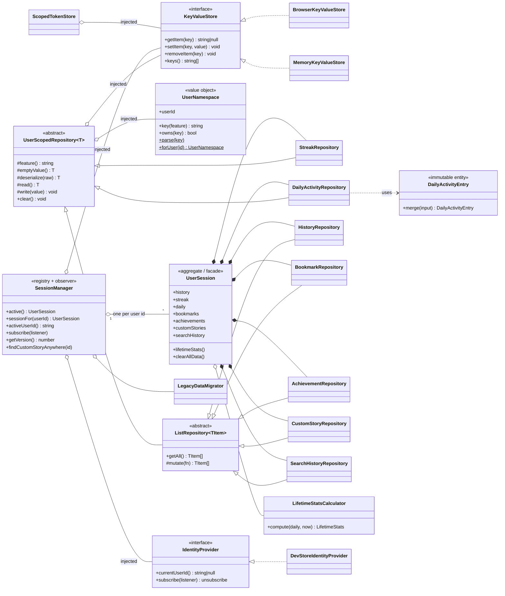

# OOP Architecture और Per-User Sessions

यह document समझाता है कि **user data हर user के लिए अलग (isolated) कैसे रखा जाता है**, **कौन-से object-oriented principles और patterns इस्तेमाल हुए हैं, क्यों, और ठीक कहाँ**। यहाँ जिस भी class और file का नाम है वह repo में मौजूद है; ऐसा कुछ भी नहीं बताया गया जो implement नहीं हुआ है।

- [1. क्या बदला और क्यों](#1-what-changed-and-why)
- [2. "Session" में क्या-क्या होता है (feature → class → screen)](#2-what-a-session-contains)
- [3. Class diagram](#3-class-diagram)
- [4. User switch पूरे system में कैसे flow होता है](#4-how-a-user-switch-flows-through-the-system)
- [5. OOP principles — क्या, क्यों, कहाँ](#5-oop-principles--what-why-where)
- [6. SOLID — एक-एक करके](#6-solid--one-by-one)
- [7. इस्तेमाल हुए Design patterns](#7-design-patterns-used)
- [8. जहाँ OOP जान-बूझकर *नहीं* इस्तेमाल हुआ](#8-where-oop-is-deliberately-not-used)
- [9. Storage layout, migration और guest session](#9-storage-layout-migration-and-the-guest-session)
- [10. Design decisions और trade-offs](#10-design-decisions-and-trade-offs)
- [11. नया per-user feature कैसे जोड़ें](#11-how-to-add-a-new-per-user-feature)
- [12. Testing](#12-testing)
- [13. ज्ञात सीमाएँ और आगे के कदम](#13-known-limitations-and-next-steps)

---

## 1. क्या बदला और क्यों

**पहले:** हर persisted feature एक global, बिना namespace वाली `localStorage` key में लिखता था
(`srt:history`, `srt:daily`, `srt:streak`, …)। एक ही browser पर login करने वाला हर व्यक्ति *वही* history, calendar, streaks, pace graphs, bookmarks और uploads देखता और बदलता था।
Backend login tokens भी पूरे browser के लिए एक ही थे, इसलिए user B के reading sessions user A के backend account में sync हो सकते थे।

**अब:** हर signed-in user का अपना **isolated `UserSession`** है — repositories का एक bundle जो सिर्फ उसी user का data पढ़ और लिख सकता है। User बदलने पर session बदलता है *और* React tree remount होता है, इसलिए कोई screen या in-memory state एक user से दूसरे में leak नहीं होता।

यह नीचे की requirements पूरी करता है:

| Requirement | कैसे |
| --- | --- |
| Graphs, consistency/streak calendar, pace आदि के लिए हर user का अलग session | `DailyActivityRepository`, `StreakRepository`, `HistoryRepository` हर user के लिए अलग बनाई जाती हैं (§2) |
| "सब कुछ" अलग, सिर्फ कुछ features नहीं | Bookmarks, achievements, uploads, search history, backend tokens और reader की in-memory state भी per-user हैं |
| सही OOP | Abstract base + hierarchy, encapsulated repositories, interfaces, composition, DI (§5–§7) |
| Documented | यही file |

---

## 2. "Session" में क्या-क्या होता है

एक `UserSession` (`lib/session/UserSession.ts`) हर feature के लिए एक repository को compose करता है। हर repository user के storage namespace में ठीक एक slot का मालिक है।

| Feature | Class | Storage slot (`srt:v2:u:<userId>:…`) | जो screens इसे पढ़ती/लिखती हैं |
| --- | --- | --- | --- |
| Reading + quiz history, quiz stats | `HistoryRepository` | `history` | `/history` (Past test attempts), `/results`, reader completion |
| **Daily activity** — contribution/streak **calendar**, daily **pace (WPM)** chart, **efficiency/break trends**, dashboard totals को data देती है | `DailyActivityRepository` | `daily` | `ContributionHeatmap`, `DailyTrendChart`, `EfficiencyTrends`, `Dashboard`, `useBreakTracker` |
| Streak counter | `StreakRepository` | `streak` | Landing page, reader completion |
| Lifetime stats (current/longest streak, averages, efficiency) | `LifetimeStatsCalculator` (pure, `UserSession.lifetimeStats()` के ज़रिए) | — (`daily` से derive होता है) | `Dashboard`, `ContributionHeatmap` header |
| Bookmarks | `BookmarkRepository` | `bookmarks` | Landing page |
| Achievements | `AchievementRepository` | `achievements` | — |
| Uploaded / custom stories | `CustomStoryRepository` | `customStories` | Library, search, `AddStoryModal`, `EditStoryModal`, "Clear all uploaded stories" |
| Search history | `SearchHistoryRepository` | `searchHistory` | `SearchBar`, `HamburgerMenu` |
| Backend (JWT) tokens | `ScopedTokenStore` | `apiAccessToken`, `apiRefreshToken` | `lib/api/*`, `AuthProvider`, notification stream |
| Reader state (current story, phase, answers, fonts) | `SessionBoundary` के ज़रिए React tree remount | in memory | reader के अंदर की हर चीज़ |

Social data (follows, likes, comments, shares, notifications, playlists) पहले से ही `lib/devData/store.ts` में `userId` से keyed records के रूप में था, इसलिए वह शुरू से per-user था और unchanged है।

---

## 3. Class diagram



File map:

```
lib/session/
  storage/KeyValueStore.ts          KeyValueStore, BrowserKeyValueStore, MemoryKeyValueStore, factory
  UserNamespace.ts                  key scheme (value object)
  UserScopedRepository.ts           UserScopedRepository (abstract) + ListRepository (abstract)
  repositories/*.ts                 History, Streak, DailyActivity, Bookmark, Achievement, CustomStory, SearchHistory
  analytics/DailyActivityEntry.ts   one day's aggregate (immutable)
  analytics/LifetimeStatsCalculator.ts  streak + average math (stateless)
  UserSession.ts                    aggregate of all repositories for one user
  SessionManager.ts                 active-user resolution, session cache, change notification
  LegacyDataMigrator.ts             one-time move of pre-session global data
  identity/IdentityProvider.ts      interface: who is signed in?
  identity/DevStoreIdentityProvider.ts  adapter over the dev login
  composition.ts                    composition root (the only place concrete classes are wired)
  useUserSession.ts                 React bindings (useSyncExternalStore)
lib/api/ScopedTokenStore.ts         per-user backend tokens
lib/storage.ts                      facade: old `storage.*` API → active user's session
components/Session/SessionBoundary.tsx  remounts the tree on user change
```

---

## 4. User switch पूरे system में कैसे flow होता है

```
Login / logout  (DevLoginGate → devDataStore.login / logout)
        │  devDataStore notifies its subscribers
        ▼
DevStoreIdentityProvider.subscribe  ──►  SessionManager.onIdentityMaybeChanged()
        │  compares resolved user id with the last one;
        │  unrelated store noise (a like, a comment) is ignored
        ▼
SessionManager.version++  →  notifies subscribers
        ▼
useActiveUserId() (useSyncExternalStore)  →  SessionBoundary re-renders
        ▼
<Fragment key={userId}>  → React unmounts & remounts the whole subtree
        ▼
Every component re-runs its effects  →  storage.* / sessionManager.active()
        ▼
Resolves the NEW user's UserSession (created once, then cached)
```

दो बातें इसे मज़बूत बनाती हैं:

1. **Call के समय resolution।** `storage.getHistory()` *हर बार* `sessionManager.active()` को call करता है;
   import के समय "current user" कहीं capture नहीं किया जाता। इसलिए गलत user की repositories का कोई पुराना (stale) reference मौजूद ही नहीं हो सकता।
2. **सिर्फ दोबारा पढ़ना नहीं, remount।** Persisted data को session layer isolate करती है, लेकिन React *state* (reader की current story, answers, cached `useState` reads) वरना switch के बाद भी बची रहती। `Fragment` को user id से key करने पर यह सब reset हो जाता है। वही user ⇒ वही key ⇒ कोई remount नहीं, इसलिए सामान्य navigation पर कोई असर नहीं पड़ता।

---

## 5. OOP principles — क्या, क्यों, कहाँ

### 5.1 Encapsulation
*State और representation को एक छोटे, मंशा साफ़ बताने वाले public API के पीछे छुपाओ।*

| कहाँ | क्या छुपा है | Public surface |
| --- | --- | --- |
| `UserScopedRepository` | storage key, JSON parsing, defensive fallbacks (`read`/`write`/`storageKey` `protected` हैं) | `clear()` + हर subclass के अपने verbs |
| `HistoryRepository` | 50-entry की cap और newest-first ordering | `add`, `update`, `quizAttempts`, `quizStats` |
| `StreakRepository` | यह कि count + last-read date एक ही record में रखे जाते हैं (इन्हें अलग-अलग गति से नहीं लिखा जा सकता) | `get`, `bump` |
| `BrowserKeyValueStore` | `window` मौजूद न हो (SSR), access throw कर सके (private mode), quota errors | `KeyValueStore` के वे 4 methods जो कभी throw नहीं करते |
| `UserNamespace` | key का format (`srt:v2:u:<id>:<feature>`) और ids का URL-encoding | `key()`, `owns()`, `parse()` |
| `DailyActivityEntry` | 12 raw counters और यह कि एक session उनमें कैसे fold होता है | `merge()`, `toJSON()` |
| `ScopedTokenStore` | namespaced keys, guest adoption, legacy-key migration | `get/set/clear` token methods |
| `UserSession` | यह कि repositories *इसी* namespace के साथ बनती हैं (`readonly` fields, कोई setter नहीं) | repository properties |

**क्यों:** callers गलत key नहीं बना सकते, cap को skip नहीं कर सकते, और आधे-बने record को mutate नहीं कर सकते। Isolation की guarantee structural है — किसी call site को user id शामिल करना "याद" नहीं रखना पड़ता।

```ts title="lib/session/UserScopedRepository.ts" principle="Encapsulation — read/write/storageKey protected हैं, इसलिए callers सिर्फ subclass के verbs इस्तेमाल कर सकते हैं"
export abstract class UserScopedRepository<T> {
  constructor(
    protected readonly store: KeyValueStore,
    protected readonly namespace: UserNamespace
  ) {}

  protected storageKey(): string {
    return this.namespace.key(this.feature());
  }

  protected read(): T {
    const raw = this.store.getItem(this.storageKey());
    if (raw === null) return this.emptyValue();
    try {
      return this.deserialize(JSON.parse(raw));
    } catch {
      return this.emptyValue();
    }
  }
}
```

### 5.2 Abstraction
*इस पर program करो कि कोई चीज़ क्या करती है, यह नहीं कि कैसे।*

- **`KeyValueStore`** "bytes कहाँ रहते हैं" को abstract करता है (browser, memory, आगे चलकर IndexedDB/API)।
- **`IdentityProvider`** "कौन signed in है" को abstract करता है (अभी dev login, आगे backend JWT)।
- **`UserScopedRepository<T>`** "एक persisted per-user value" को abstract करता है — `UserSession.clearAllData()`
  सात अलग-अलग repositories को इसी एक type के ज़रिए clear करता है, बिना यह जाने कि कौन-सी कौन है।

**क्यों:** session layer को `localStorage` या dev login के बारे में कुछ पता नहीं है, इसलिए किसी भी एक repository को छुए बिना दोनों में से कोई भी बदला जा सकता है।

```ts title="lib/session/storage/KeyValueStore.ts" principle="Abstraction + Dependency Inversion — repositories इसी interface पर निर्भर करती हैं, localStorage पर कभी नहीं"
export interface KeyValueStore {
  getItem(key: string): string | null;
  setItem(key: string, value: string): void;
  removeItem(key: string): void;
  keys(): string[];
}
```

### 5.3 Inheritance (कम इस्तेमाल, दो levels)
*जो algorithm हमेशा एक जैसा रहता है उसे reuse करो; सिर्फ वही specialise करो जो बदलता है।*

```
UserScopedRepository<T>            read / write / clear / key building   (abstract)
 ├─ StreakRepository               object value
 ├─ DailyActivityRepository        map value
 └─ ListRepository<TItem>          array value: getAll / mutate           (abstract)
     ├─ HistoryRepository          cap 50, update-in-place, quiz stats
     ├─ BookmarkRepository         toggle
     ├─ AchievementRepository      idempotent unlock
     ├─ CustomStoryRepository      upsert by id, ownership check
     └─ SearchHistoryRepository    cap 30, case-insensitive de-dupe
```

**यहाँ inheritance क्यों:** सातों repositories ==एक *असली* "is-a" संबंध और एक algorithm== साझा करती हैं। `ListRepository` इसलिए है क्योंकि इनमें से पाँच lists हैं और वरना हर एक को empty-array default, "क्या यह सच में array है?" वाला guard और read-modify-write दोबारा लिखना पड़ता। ==Hierarchy जान-बूझकर दो levels पर रुक जाती है== — गहरे trees brittle हो जाते हैं।

```ts title="lib/session/repositories/SearchHistoryRepository.ts" principle="Inheritance + Template Method — base class read/write संभालती है, यह subclass सिर्फ बदलने वाले hooks भरती है"
export class SearchHistoryRepository extends ListRepository<SearchHistoryEntry> {
  static readonly MAX_ENTRIES = 30;

  protected feature(): string {
    return "searchHistory";
  }

  protected deserialize(raw: unknown): SearchHistoryEntry[] {
    if (!Array.isArray(raw)) return [];
    const now = new Date().toISOString();
    return raw.map((entry) => (typeof entry === "string" ? { term: entry, date: now } : (entry as SearchHistoryEntry)));
  }
}
```

### 5.4 Polymorphism
*==एक call, concrete type के हिसाब से अलग behavior।==*

- **Template Method hooks।** Base class का `read()` `this.deserialize(...)` और
  `this.emptyValue()` को call करता है। `SearchHistoryRepository` पुराने `string[]` shape को upgrade करने के लिए `deserialize` को override करती है; `StreakRepository` इसे object validate करने के लिए override करती है; base flow कभी नहीं बदलता।
- **Interface polymorphism।** `BrowserKeyValueStore` और `MemoryKeyValueStore` `KeyValueStore` के पीछे आपस में बदले जा सकते हैं (tests `localStorage` की जगह memory वाली इस्तेमाल करते हैं)।
- **एक जैसा व्यवहार।** `UserSession.clearAllData()` `ReadonlyArray<UserScopedRepository<unknown>>` पर loop करता है और हर एक पर `clear()` call करता है।

```ts title="lib/session/UserSession.ts" principle="Polymorphism — एक call, सात अलग repositories, हर एक अपना data खुद clear करती है"
private readonly repositories: ReadonlyArray<UserScopedRepository<unknown>>;

/** Wipes every feature's data for *this user only*. */
clearAllData(): void {
  this.repositories.forEach((repo) => repo.clear());
}
```

### 5.5 Inheritance की जगह Composition
*बड़ी चीज़ें छोटे collaborators को जोड़कर बनाओ।*

- `UserSession` के **पास** सात repositories और एक `LifetimeStatsCalculator` **हैं** — यह उनसे inherit नहीं करता।
- `DailyActivityRepository` merge rule को अपने अंदर embed करने की बजाय `DailyActivityEntry` **इस्तेमाल करती है**।
- `SessionManager` के **पास** एक store, एक identity provider और एक migrator **हैं**, तीनों inject किए हुए।

**क्यों:** "किसी user का session" कोई तरह की repository नहीं है; वह उनका एक bundle है। Composition हर हिस्से को अलग से testable और replaceable रखता है।

```ts title="lib/session/UserSession.ts" principle="Composition over inheritance — UserSession के पास repositories हैं; सब एक ही namespace साझा करती हैं, जो construction पर bind होता है"
constructor(
  readonly namespace: UserNamespace,
  store: KeyValueStore,
  private readonly stats: LifetimeStatsCalculator = new LifetimeStatsCalculator()
) {
  this.history = new HistoryRepository(store, namespace);
  // …one repository per feature, same namespace
}
```

### 5.6 Immutability / value objects
`UserNamespace` और `DailyActivityEntry` construction के बाद कभी नहीं बदलते (`merge` एक नया entry return करता है)।
**क्यों:** आधा-लागू हुआ update न दिख सकता है और न save हो सकता है, और बराबर namespaces आपस में interchangeable हैं।

```ts title="lib/session/UserNamespace.ts" principle="Value object + private constructor/static factory — खाली id कभी बिना-namespace वाली key नहीं बना सकती"
export class UserNamespace {
  static readonly GUEST_ID = "guest";

  private constructor(readonly userId: string) {}

  static forUser(userId: string | null | undefined): UserNamespace {
    const trimmed = userId?.trim();
    return new UserNamespace(trimmed ? trimmed : UserNamespace.GUEST_ID);
  }
}
```

---

## 6. SOLID — एक-एक करके

| Principle | कहाँ दिखता है |
| --- | --- |
| **S**ingle Responsibility | `LifetimeStatsCalculator` सिर्फ compute करता है (storage नहीं); repositories सिर्फ persist करती हैं (stat math नहीं); `SessionManager` सिर्फ resolve/cache/notify करता है; `LegacyDataMigrator` सिर्फ migrate करता है; `UserNamespace` सिर्फ key scheme जानता है। |
| **O**pen/Closed | नया per-user feature = नया subclass + `UserSession` में एक registration (§11)। कोई मौजूदा repository edit नहीं होती। नया store या identity source = interface implement करने वाली नई class। |
| **L**iskov Substitution | कोई भी `KeyValueStore` वहाँ काम करता है जहाँ एक की ज़रूरत हो; कोई भी `ListRepository` subclass `getAll()`/`mutate()` का पालन करती है; `MemoryKeyValueStore` browser store की जगह सीधे लग जाता है (test suite का बिना browser चलना इसका सबूत है)। |
| **I**nterface Segregation | `KeyValueStore` में 4 methods हैं; `IdentityProvider` में 2; `DevIdentitySource` (adapter को dev store से जो चाहिए) में 2। किसी को ऐसे methods पर निर्भर होने को मजबूर नहीं किया जाता जो वह इस्तेमाल नहीं करता। |
| **D**ependency Inversion | Repositories `KeyValueStore` + `UserNamespace` पर निर्भर करती हैं, `localStorage` पर नहीं। `SessionManager` `IdentityProvider` पर निर्भर करता है, dev store पर नहीं। Concrete classes ठीक एक ही जगह चुनी जाती हैं: `composition.ts`। |

---

## 7. इस्तेमाल हुए Design patterns

| Pattern | Class / file | मकसद |
| --- | --- | --- |
| **Repository** | सभी `*Repository` classes | हर feature के data को पढ़ने/लिखने का ज़िम्मा एक object का; UI कभी storage को नहीं छूता। |
| **Template Method** | `UserScopedRepository` (`feature`, `emptyValue`, `deserialize`, `serialize` hooks) | पढ़ने/लिखने का algorithm तय, बदलने वाले steps subclasses में। |
| **Facade** | `UserSession`; `lib/storage.ts` | `UserSession` सात repositories का एक ही entry point देता है। `storage.*` पुराना API बनाए रखता है, इसलिए 34 मौजूदा call sites बिना किसी edit के per-user हो गए। |
| **Aggregate / Composition Root** | `UserSession`; `composition.ts` | हर user के लिए एक consistent unit; एक ही जगह जहाँ concrete classes जोड़ी जाती हैं। |
| **Observer** | `SessionManager.subscribe/getVersion` (+ `useSyncExternalStore`) | active user बदलने पर React re-render होता है। `devDataStore` जैसी ही shape। |
| **Registry / Flyweight-style cache** | `SessionManager.sessions` (`Map<userId, UserSession>`) | हर user के लिए ठीक एक session object, lazily बनता और दोबारा इस्तेमाल होता है। |
| **Adapter** | `DevStoreIdentityProvider` | dev login को `IdentityProvider` के रूप में पेश करता है; भविष्य का `ApiIdentityProvider` इसके बगल में लग जाएगा। |
| **Factory** | `createDefaultKeyValueStore()` | runtime के हिसाब से browser या memory store चुनता है (SSR-safe)। |
| **Value Object** | `UserNamespace`, `DailyActivityEntry` | Immutable, value से compare होते हैं। |
| **Singleton (module scope से)** | `sessionManager`, `tokenStore` | हर page पर एक instance। `composition.ts`/`tokenStore.ts` में बनता है, अपनी dependencies *inject होकर* — इसलिए classes testable रहती हैं (tests अपने instances बनाते हैं)। |

---

## 8. जहाँ OOP जान-बूझकर *नहीं* इस्तेमाल हुआ

ईमानदार scope, ताकि यहाँ कुछ भी बढ़ा-चढ़ाकर न बताया जाए:

- **React components और hooks function components ही रहते हैं।** Class components आधुनिक React में deprecated हैं और hooks/Server Components से टकराते हैं। OOP उनके नीचे की *domain और data layer* पर लगाया गया है — जहाँ stateful logic और invariants रहते हैं। (`lib/devData/store.ts` का `DevDataStore` पहले से ही Observer pattern वाली class थी; वह unchanged है।)
- **`ReadingContext` एक reducer है।** Reading-flow के transitions के लिए finite-state machine (`useReducer`) सही model है; उसे classes में लपेटने से ceremony बढ़ती, clarity नहीं।
- **Backend (`speed-reader-backend`) इस बदलाव में refactor नहीं हुआ।**
  - इसका user-owned data database level पर पहले से per-user है: reading history और stats
    (`where: { userId }`), notifications (`recipientId` से), playlists (ownership-checked), और
    refresh-token sessions (`revokedAt` वाली `RefreshToken` table, use होने पर rotate होती है, reuse detection के साथ)। Public content
    — stories और feeds — जान-बूझकर सभी users में साझा है।
  - यह जहाँ मायने रखता है वहाँ पहले से OOP इस्तेमाल करता है: `AppError` hierarchy (`NotFoundError`,
    `UnauthorizedError`, `ForbiddenError`, `ConflictError`, `ValidationError`) क्लासिक
    inheritance + polymorphism है, जिसे central error handler इस्तेमाल करता है।
  - इसकी services module-level functions हैं। उन्हें constructor-injected Prisma client वाली classes में बदलना स्वाभाविक अगला कदम है (§13), लेकिन जिस environment में यह बना, वहाँ मैं backend बदलावों को type-check नहीं कर सका (npm registry unreachable थी, इसलिए Express/Prisma types नहीं थे), और मैं auth/data code का बिना verify किया refactor ship नहीं करना चाहता था।

---

## 9. Storage layout, migration और guest session

### Key scheme

```
srt:v2:u:<encodeURIComponent(userId)>:<feature>

srt:v2:u:user-1:history
srt:v2:u:user-1:daily
srt:v2:u:user-2:history        ← a different key by construction; collisions are impossible
```

`UserNamespace.parse(key)` इसका उल्टा है, जिससे दूसरे users के namespaces खोजे जाते हैं।

### Legacy data (कोई data loss नहीं)
पुराने builds global keys (`srt:history`, `srt:daily`, …) लिखते थे। `LegacyDataMigrator`:

1. तब चलता है जब किसी **non-guest** user का session पहली बार बनता है।
2. हर legacy key को उस user के namespace में copy करता है (दो-key वाली streak एक record बन जाती है),
   user के पास जो data पहले से है उसे **कभी overwrite नहीं करता**।
3. Legacy keys delete करता है और `srt:v2:legacy-claimed-by = <userId>` लिख देता है।
4. इसलिए **update के बाद sign in करने वाला पहला असली user पुराना data inherit करता है**, और कोई दूसरा user नहीं कर सकता।

### Guest session
जब कोई signed in नहीं होता, active namespace `guest` होता है। यह कभी legacy data claim नहीं करता। (व्यवहार में app login gate दिखाती है, इसलिए guest के रूप में कुछ persist नहीं होता — सिवाय login screen पर किए गए backend login के, जिसे अगला user *adopt* कर लेता है, नीचे देखें।)

### Backend tokens
`ScopedTokenStore` हर user की JWT pair को उसके अपने namespace में रखता है। Login screen demo persona चुनने से *पहले* backend account connect करने देती है, इसलिए वे tokens guest slot में जाते हैं; **पहला असली user जो tokens पढ़ता है और जिसके पास अपने नहीं हैं, उन्हें adopt कर लेता है (copy नहीं, move)**। Pre-session browser-wide tokens भी इसी तरह adopt होते हैं। `AuthProvider` `SessionBoundary` के अंदर बैठता है, ताकि वह हर user के लिए backend login को फिर से restore करे।

---

## 10. Design decisions और trade-offs

- **Logical isolation, security boundary नहीं।** यह सब एक ही browser की
  `localStorage` में रहता है; dev-tools वाला कोई भी किसी भी namespace को पढ़ सकता है। यह users के बीच *गलती से* मिलने को रोकता है और हर user को साफ़, consistent अनुभव देता है। असली security boundary
  backend है (JWT + `where: { userId }`)।
- **Uploads per-user हैं; shared stories फिर भी खुलती हैं।** हर user की uploaded stories सिर्फ उसकी अपनी library, search और feed में रहती हैं। लेकिन notification में सिर्फ content id होती है, इसलिए
  `getStoryById()` users के पार एक **read-only** lookup पर fallback करता है
  (`SessionManager.findCustomStoryAnywhere`), ताकि किसी ने जो story आपसे share की वह खुल सके। इससे कोई ownership नहीं मिलती — edit/delete buttons `isCustomStory()` इस्तेमाल करते हैं, जो सिर्फ active user के अपने uploads जाँचता है।
- **Rewrite की जगह Facade।** `storage.*` को unchanged रखने से हर screen के लिए isolation का बदलाव zero-risk रहा। नया code `useUserSession()` / repositories को सीधे इस्तेमाल करे।
- **Lazy session resolution।** `sessionManager.active()` हर call पर resolve होता है, capture नहीं, ताकि switch के बाद कोई stale session इस्तेमाल न हो सके।
- **Switch पर remount।** दोबारा पढ़ने से थोड़ा ज़्यादा काम, लेकिन यही अकेला तरीका है जिससे guarantee मिलती है कि कोई in-memory state (current story, quiz answers, cached reads) users के बीच leak न हो।
- **सीमित inheritance depth।** दो levels, जिन्हें एक सच्चा साझा algorithm justify करता है; बाकी सब composition है।

---

## 11. नया per-user feature कैसे जोड़ें

उदाहरण: हर user की आखिरी बार इस्तेमाल की गई reading speed याद रखना।

```ts
// lib/session/repositories/PreferenceRepository.ts
import { UserScopedRepository } from "@/lib/session/UserScopedRepository";

export class PreferenceRepository extends UserScopedRepository<{ wpm: number }> {
  protected feature() { return "preferences"; }
  protected emptyValue() { return { wpm: 250 }; }
  getWpm() { return this.read().wpm; }
  setWpm(wpm: number) { this.write({ wpm }); }
}
```

फिर इसे `UserSession` में register करें:

```ts
readonly preferences: PreferenceRepository;
// constructor:
this.preferences = new PreferenceRepository(store, namespace);
// and add `this.preferences` to the `repositories` array so clearAllData() covers it.
```

बस इतना ही बदलाव है — isolation, caching, user switching और substitution से testing सब मुफ़्त मिलते हैं।
React से इसे `const { preferences } = useUserSession();` के साथ इस्तेमाल करें।

---

## 12. Testing

```bash
npx tsx scripts/session-isolation.test.ts      # or: npm run test:session
```

यह सादे Node में चलता है (कोई browser नहीं, कोई framework नहीं) क्योंकि layer सिर्फ interfaces पर निर्भर है
(`MemoryKeyValueStore` + एक नकली `IdentityProvider`)। **21 tests**, जो ये cover करते हैं:

- history, quiz attempts/stats, daily activity (calendar/pace/efficiency का source), streaks, bookmarks,
  achievements, search history और uploads **कभी users के बीच cross नहीं करते**
- caps (50 history / 30 searches), update-in-place, idempotent unlock, case-insensitive search de-dupe
- streak rules (वही दिन / अगला दिन / gap) और lifetime-streak math, "आज अभी नहीं पढ़ा" वाली grace सहित
- `clear()` / `clearAllData()` सिर्फ एक user को प्रभावित करते हैं
- पुरानी `string[]` search history upgrade होती है; corrupt JSON खाली में degrade होता है, कभी throw नहीं करता
- namespace keys round-trip होती हैं, `:` `/` `%` वाले ids के लिए भी; कोई prefix collision नहीं
- user switching, session caching, version bumps **सिर्फ** असली user बदलने पर (असंबंधित store noise पर नहीं)
- data sign-out/sign-in और simulated reload के बाद भी बचा रहता है
- shared-story lookup read-only है; ownership हर user की अपनी रहती है
- legacy migration: पहला असली user एक बार claim करता है, guest कभी claim नहीं करता, कभी overwrite नहीं होता
- backend tokens: per-user, guest-login ठीक एक user द्वारा adopt, legacy tokens एक बार adopt

इसके अलावा, एक one-off **differential test** ने नए `LifetimeStatsCalculator` +
`DailyActivityRepository` की तुलना *original* `storage.ts` से **300 randomized histories** पर की — सभी outputs identical निकले, यानी refactor ने सिर्फ यह बदला कि data कहाँ रहता है, यह नहीं कि numbers क्या हैं।

Session layer और बदली हुई API files `tsc --strict` भी पास करती हैं।

---

## 13. ज्ञात सीमाएँ और आगे के कदम

1. **Backend का class-based refactor** (नहीं हुआ — §8 देखें)। योजना: हर module के लिए एक class
   (`HistoryService`, `PlaylistService`, …) जो constructor में `PrismaClient` (और ज़रूरत हो तो Redis/S3) ले; controllers ऐसी classes जिन्हें service मिले; module-level `import { prisma }` की जगह एक छोटा composition root। इसे वहाँ करें जहाँ `npm run build` इसे verify कर सके।
2. **Social store अब भी एक साझा in-browser store है।** `DevDataStore` एक ही class है जो सभी 20 demo users के records (`userId` से keyed) रखती है, जो social features को चाहिए। जब असली backend संभालेगा, तो इसे बदला जाएगा, बढ़ाया नहीं जाएगा।
3. **Reader preferences (font, theme, speed) persist नहीं होतीं** — कभी होती ही नहीं थीं, और remount की वजह से हर user के लिए reset होती हैं। §11 दिखाता है कि चाहें तो इन्हें per-user कैसे persist करें।
4. **भविष्य का `ApiIdentityProvider`** (identity source के रूप में backend JWT) `composition.ts` में एक class जोड़ने जितना काम है;
   repositories में कोई बदलाव नहीं।
