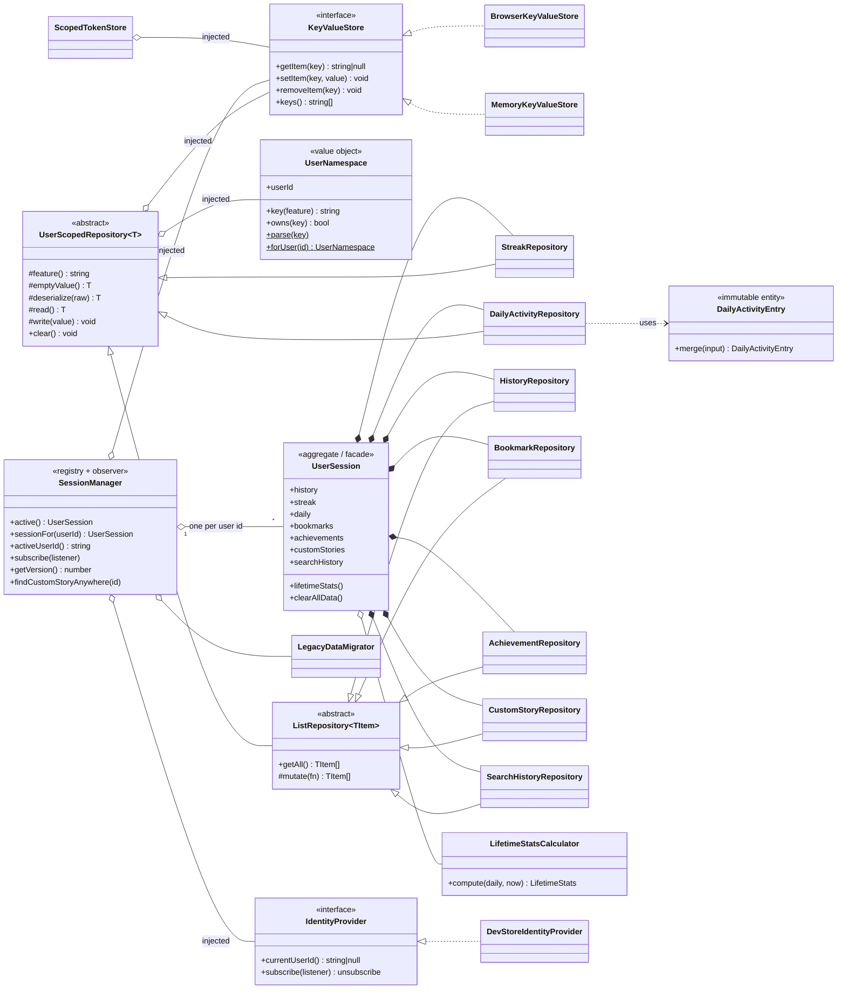

# OOP Architecture & Per-User Sessions

This document explains **how user data is isolated per user**, **which object-oriented
principles and patterns are used, why, and exactly where**. Every class and file named
here exists in the repo; nothing is described that isn't implemented.

- [1. What changed and why](#1-what-changed-and-why)
- [2. What "a session" contains (feature → class → screen)](#2-what-a-session-contains)
- [3. Class diagram](#3-class-diagram)
- [4. How a user switch flows through the system](#4-how-a-user-switch-flows-through-the-system)
- [5. OOP principles — what, why, where](#5-oop-principles--what-why-where)
- [6. SOLID — one by one](#6-solid--one-by-one)
- [7. Design patterns used](#7-design-patterns-used)
- [8. Where OOP is deliberately *not* used](#8-where-oop-is-deliberately-not-used)
- [9. Storage layout, migration and the guest session](#9-storage-layout-migration-and-the-guest-session)
- [10. Design decisions and trade-offs](#10-design-decisions-and-trade-offs)
- [11. How to add a new per-user feature](#11-how-to-add-a-new-per-user-feature)
- [12. Testing](#12-testing)
- [13. Known limitations and next steps](#13-known-limitations-and-next-steps)

---

## 1. What changed and why

**Before:** every persisted feature wrote to one global, un-namespaced `localStorage` key
(`srt:history`, `srt:daily`, `srt:streak`, …). Anyone who logged in on the same browser saw
and changed the *same* history, calendar, streaks, pace graphs, bookmarks and uploads.
Backend login tokens were browser-wide too, so user B's reading sessions could be synced into
user A's backend account.

**Now:** every signed-in user has their **own isolated `UserSession`** — a bundle of
repositories that can only read and write that user's data. Switching user switches the
session *and* remounts the React tree, so no screen or in-memory state leaks across users.

Requirements this satisfies:

| Requirement | How |
| --- | --- |
| Separate session per user for graphs, consistency/streak calendar, pace, etc. | `DailyActivityRepository`, `StreakRepository`, `HistoryRepository` are constructed per user (§2) |
| "Everything" separate, not just some features | Bookmarks, achievements, uploads, search history, backend tokens, and the reader's in-memory state are all per-user too |
| Proper OOP | Abstract base + hierarchy, encapsulated repositories, interfaces, composition, DI (§5–§7) |
| Documented | This file |

---

## 2. What "a session" contains

One `UserSession` (`lib/session/UserSession.ts`) composes one repository per feature. Each
repository owns exactly one slot in the user's storage namespace.

| Feature | Class | Storage slot (`srt:v2:u:<userId>:…`) | Screens that read/write it |
| --- | --- | --- | --- |
| Reading + quiz history, quiz stats | `HistoryRepository` | `history` | `/history` (Past test attempts), `/results`, reader completion |
| **Daily activity** — feeds the contribution/streak **calendar**, the daily **pace (WPM)** chart, the **efficiency/break trends**, dashboard totals | `DailyActivityRepository` | `daily` | `ContributionHeatmap`, `DailyTrendChart`, `EfficiencyTrends`, `Dashboard`, `useBreakTracker` |
| Streak counter | `StreakRepository` | `streak` | Landing page, reader completion |
| Lifetime stats (current/longest streak, averages, efficiency) | `LifetimeStatsCalculator` (pure, via `UserSession.lifetimeStats()`) | — (derived from `daily`) | `Dashboard`, `ContributionHeatmap` header |
| Bookmarks | `BookmarkRepository` | `bookmarks` | Landing page |
| Achievements | `AchievementRepository` | `achievements` | — |
| Uploaded / custom stories | `CustomStoryRepository` | `customStories` | Library, search, `AddStoryModal`, `EditStoryModal`, "Clear all uploaded stories" |
| Search history | `SearchHistoryRepository` | `searchHistory` | `SearchBar`, `HamburgerMenu` |
| Backend (JWT) tokens | `ScopedTokenStore` | `apiAccessToken`, `apiRefreshToken` | `lib/api/*`, `AuthProvider`, notification stream |
| Reader state (current story, phase, answers, fonts) | React tree remount via `SessionBoundary` | in memory | everything under the reader |

Social data (follows, likes, comments, shares, notifications, playlists) already lived in
`lib/devData/store.ts` as records keyed by `userId`, so it was per-user by construction and is
unchanged.

---

## 3. Class diagram



File map:

```
lib/session/
  storage/KeyValueStore.ts          KeyValueStore, BrowserKeyValueStore, MemoryKeyValueStore, factory
  UserNamespace.ts                  key scheme (value object)
  UserScopedRepository.ts           UserScopedRepository (abstract) + ListRepository (abstract)
  repositories/*.ts                 History, Streak, DailyActivity, Bookmark, Achievement, CustomStory, SearchHistory
  analytics/DailyActivityEntry.ts   one day's aggregate (immutable)
  analytics/LifetimeStatsCalculator.ts  streak + average math (stateless)
  UserSession.ts                    aggregate of all repositories for one user
  SessionManager.ts                 active-user resolution, session cache, change notification
  LegacyDataMigrator.ts             one-time move of pre-session global data
  identity/IdentityProvider.ts      interface: who is signed in?
  identity/DevStoreIdentityProvider.ts  adapter over the dev login
  composition.ts                    composition root (the only place concrete classes are wired)
  useUserSession.ts                 React bindings (useSyncExternalStore)
lib/api/ScopedTokenStore.ts         per-user backend tokens
lib/storage.ts                      facade: old `storage.*` API → active user's session
components/Session/SessionBoundary.tsx  remounts the tree on user change
```

---

## 4. How a user switch flows through the system

```
Login / logout  (DevLoginGate → devDataStore.login / logout)
        │  devDataStore notifies its subscribers
        ▼
DevStoreIdentityProvider.subscribe  ──►  SessionManager.onIdentityMaybeChanged()
        │  compares resolved user id with the last one;
        │  unrelated store noise (a like, a comment) is ignored
        ▼
SessionManager.version++  →  notifies subscribers
        ▼
useActiveUserId() (useSyncExternalStore)  →  SessionBoundary re-renders
        ▼
<Fragment key={userId}>  → React unmounts & remounts the whole subtree
        ▼
Every component re-runs its effects  →  storage.* / sessionManager.active()
        ▼
Resolves the NEW user's UserSession (created once, then cached)
```

Two things make this robust:

1. **Resolution at call time.** `storage.getHistory()` calls `sessionManager.active()` *each time*;
   nothing captures "the current user" at import. A stale reference to the wrong user's
   repositories cannot exist.
2. **Remount, not just re-read.** Persisted data is isolated by the session layer, but React
   *state* (the reader's current story, answers, cached `useState` reads) would otherwise survive
   a switch. Keying a `Fragment` by user id resets all of it. Same user ⇒ same key ⇒ no remount,
   so ordinary navigation is unaffected.

---

## 5. OOP principles — what, why, where

### 5.1 Encapsulation
*Hide state and representation behind a small, intention-revealing public API.*

| Where | What is hidden | Public surface |
| --- | --- | --- |
| `UserScopedRepository` | storage key, JSON parsing, defensive fallbacks (`read`/`write`/`storageKey` are `protected`) | `clear()` + each subclass's verbs |
| `HistoryRepository` | the 50-entry cap and newest-first ordering | `add`, `update`, `quizAttempts`, `quizStats` |
| `StreakRepository` | that count + last-read date are stored as one record (they can't be written out of step) | `get`, `bump` |
| `BrowserKeyValueStore` | `window` may not exist (SSR), access may throw (private mode), quota errors | the 4 `KeyValueStore` methods that never throw |
| `UserNamespace` | the key format (`srt:v2:u:<id>:<feature>`) and URL-encoding of ids | `key()`, `owns()`, `parse()` |
| `DailyActivityEntry` | the 12 raw counters and how a session folds into them | `merge()`, `toJSON()` |
| `ScopedTokenStore` | namespaced keys, guest adoption, legacy-key migration | `get/set/clear` token methods |
| `UserSession` | that repositories are constructed with *this* namespace (`readonly` fields, no setters) | repository properties |

**Why:** callers can't produce a wrong key, skip the cap, or mutate a half-built record. The
isolation guarantee is structural — no call site has to "remember" to include the user id.

### 5.2 Abstraction
*Program against what something does, not how.*

- **`KeyValueStore`** abstracts "where bytes live" (browser, memory, later IndexedDB/API).
- **`IdentityProvider`** abstracts "who is signed in" (dev login now, backend JWT later).
- **`UserScopedRepository<T>`** abstracts "a persisted per-user value" — `UserSession.clearAllData()`
  clears seven different repositories through this one type without knowing which is which.

**Why:** the session layer has no knowledge of `localStorage` or of the dev login, so either can be
replaced without touching a single repository.

### 5.3 Inheritance (used sparingly, two levels)
*Reuse an invariant algorithm; specialise only what varies.*

```
UserScopedRepository<T>            read / write / clear / key building   (abstract)
 ├─ StreakRepository               object value
 ├─ DailyActivityRepository        map value
 └─ ListRepository<TItem>          array value: getAll / mutate           (abstract)
     ├─ HistoryRepository          cap 50, update-in-place, quiz stats
     ├─ BookmarkRepository         toggle
     ├─ AchievementRepository      idempotent unlock
     ├─ CustomStoryRepository      upsert by id, ownership check
     └─ SearchHistoryRepository    cap 30, case-insensitive de-dupe
```

**Why inheritance here:** seven repositories share one *real* "is-a" relationship and one
algorithm. `ListRepository` exists because five of them are lists and would otherwise each
re-write the empty-array default, the "is it really an array?" guard and read-modify-write. The
hierarchy stops at two levels on purpose — deeper trees get brittle.

### 5.4 Polymorphism
*One call, different behavior depending on the concrete type.*

- **Template Method hooks.** The base class's `read()` calls `this.deserialize(...)` and
  `this.emptyValue()`. `SearchHistoryRepository` overrides `deserialize` to upgrade the older
  `string[]` shape; `StreakRepository` overrides it to validate an object; the base flow never changes.
- **Interface polymorphism.** `BrowserKeyValueStore` and `MemoryKeyValueStore` are interchangeable
  behind `KeyValueStore` (the tests use the memory one in place of `localStorage`).
- **Uniform treatment.** `UserSession.clearAllData()` loops
  `ReadonlyArray<UserScopedRepository<unknown>>` and calls `clear()` on each.

### 5.5 Composition over inheritance
*Build big things by combining small collaborators.*

- `UserSession` **has** seven repositories and a `LifetimeStatsCalculator` — it doesn't inherit from them.
- `DailyActivityRepository` **uses** `DailyActivityEntry` for the merge rule instead of embedding it.
- `SessionManager` **has** a store, an identity provider and a migrator, all injected.

**Why:** "a user's session" isn't a kind of repository; it's a bundle of them. Composition keeps each
piece independently testable and replaceable.

### 5.6 Immutability / value objects
`UserNamespace` and `DailyActivityEntry` never change after construction (`merge` returns a new entry).
**Why:** a half-applied update can't be observed or saved, and equal namespaces are interchangeable.

---

## 6. SOLID — one by one

| Principle | Where it shows up |
| --- | --- |
| **S**ingle Responsibility | `LifetimeStatsCalculator` only computes (no storage); repositories only persist (no stat math); `SessionManager` only resolves/caches/notifies; `LegacyDataMigrator` only migrates; `UserNamespace` only knows the key scheme. |
| **O**pen/Closed | New per-user feature = new subclass + one registration in `UserSession` (§11). No existing repository is edited. A new store or identity source = new class implementing an interface. |
| **L**iskov Substitution | Any `KeyValueStore` works anywhere one is expected; any `ListRepository` subclass honours `getAll()`/`mutate()`; `MemoryKeyValueStore` is a drop-in for the browser store (proved by the test suite running with no browser). |
| **I**nterface Segregation | `KeyValueStore` is 4 methods; `IdentityProvider` is 2; `DevIdentitySource` (what the adapter needs from the dev store) is 2. Nothing is forced to depend on methods it doesn't use. |
| **D**ependency Inversion | Repositories depend on `KeyValueStore` + `UserNamespace`, not on `localStorage`. `SessionManager` depends on `IdentityProvider`, not on the dev store. Concrete classes are chosen in exactly one place: `composition.ts`. |

---

## 7. Design patterns used

| Pattern | Class / file | Purpose |
| --- | --- | --- |
| **Repository** | all `*Repository` classes | One object per feature owns reading/writing that data; UI never touches storage. |
| **Template Method** | `UserScopedRepository` (`feature`, `emptyValue`, `deserialize`, `serialize` hooks) | Fixed read/write algorithm, varying steps in subclasses. |
| **Facade** | `UserSession`; `lib/storage.ts` | `UserSession` gives one entry point to seven repositories. `storage.*` keeps the old API so the 34 existing call sites became per-user with zero edits. |
| **Aggregate / Composition Root** | `UserSession`; `composition.ts` | One consistent unit per user; one place that wires concrete classes. |
| **Observer** | `SessionManager.subscribe/getVersion` (+ `useSyncExternalStore`) | React re-renders when the active user changes. Same shape as `devDataStore`. |
| **Registry / Flyweight-style cache** | `SessionManager.sessions` (`Map<userId, UserSession>`) | Exactly one session object per user, created lazily and reused. |
| **Adapter** | `DevStoreIdentityProvider` | Presents the dev login as an `IdentityProvider`; a future `ApiIdentityProvider` slots in beside it. |
| **Factory** | `createDefaultKeyValueStore()` | Picks browser vs memory store for the runtime (SSR-safe). |
| **Value Object** | `UserNamespace`, `DailyActivityEntry` | Immutable, compared by value. |
| **Singleton (by module scope)** | `sessionManager`, `tokenStore` | One instance per page. Created in `composition.ts`/`tokenStore.ts`, *injected with* its dependencies — so classes stay testable (tests build their own instances). |

---

## 8. Where OOP is deliberately *not* used

Honest scope, so nothing here is overstated:

- **React components and hooks stay function components.** Class components are deprecated in
  modern React and fight hooks/Server Components. OOP is applied to the *domain and data layer*
  underneath them — which is where stateful logic and invariants live. (`DevDataStore` in
  `lib/devData/store.ts` was already a class with the Observer pattern; it's unchanged.)
- **`ReadingContext` is a reducer.** A finite-state machine (`useReducer`) is the right model for the
  reading-flow transitions; wrapping it in classes would add ceremony, not clarity.
- **The backend (`speed-reader-backend`) was not refactored in this change.**
  - Its user-owned data is already per-user at the database level: reading history and stats
    (`where: { userId }`), notifications (by `recipientId`), playlists (ownership-checked), and
    refresh-token sessions (a `RefreshToken` table with `revokedAt`, rotated on use, with reuse detection). Public content
    — stories and feeds — is intentionally shared across users.
  - It already uses OOP where it matters: the `AppError` hierarchy (`NotFoundError`,
    `UnauthorizedError`, `ForbiddenError`, `ConflictError`, `ValidationError`) is classic
    inheritance + polymorphism, consumed by the central error handler.
  - Its services are module-level functions. Converting them to classes with a constructor-injected
    Prisma client is the natural next step (§13), but I could not type-check backend changes in the
    environment this was built in (npm registry unreachable, so no Express/Prisma types), and I
    would rather not ship an unverified refactor of auth/data code.

---

## 9. Storage layout, migration and the guest session

### Key scheme

```
srt:v2:u:<encodeURIComponent(userId)>:<feature>

srt:v2:u:user-1:history
srt:v2:u:user-1:daily
srt:v2:u:user-2:history        ← a different key by construction; collisions are impossible
```

`UserNamespace.parse(key)` is the inverse, used to discover other users' namespaces.

### Legacy data (no data loss)
Old builds wrote global keys (`srt:history`, `srt:daily`, …). `LegacyDataMigrator`:

1. Runs when a **non-guest** user's session is first created.
2. Copies each legacy key into that user's namespace (the two-key streak becomes one record),
   **never overwriting** data the user already has.
3. Deletes the legacy keys and writes `srt:v2:legacy-claimed-by = <userId>`.
4. So the **first real user to sign in after the update inherits the old data**, and no second user can.

### Guest session
When nobody is signed in, the active namespace is `guest`. It never claims legacy data. (In
practice the app shows the login gate, so nothing is persisted as guest — except a backend login
made on the login screen, which is *adopted* by the next user, see below.)

### Backend tokens
`ScopedTokenStore` keeps each user's JWT pair in their own namespace. The login screen allows
connecting a backend account *before* choosing a demo persona, so those tokens land in the guest
slot; the **first real user who reads tokens with none of their own adopts them (moved, not
copied)**. Pre-session browser-wide tokens are adopted the same way. `AuthProvider` sits inside
`SessionBoundary` so it re-restores the backend login for each user.

---

## 10. Design decisions and trade-offs

- **Logical isolation, not a security boundary.** All of it lives in the same browser's
  `localStorage`; anyone with dev-tools can read any namespace. This stops *accidental* mixing
  between users and gives each user a clean, consistent experience. The real security boundary is
  the backend (JWT + `where: { userId }`).
- **Uploads are per-user; shared stories still open.** Each user's uploaded stories live only in
  their own library, search and feed. But a notification only carries a content id, so
  `getStoryById()` falls back to a **read-only** lookup across users
  (`SessionManager.findCustomStoryAnywhere`) so a story someone shared with you can open. That
  grants no ownership — edit/delete buttons use `isCustomStory()`, which checks only the active
  user's own uploads.
- **Facade over rewrite.** Keeping `storage.*` unchanged made the isolation change zero-risk for
  every screen. New code should use `useUserSession()` / the repositories directly.
- **Lazy session resolution.** `sessionManager.active()` is resolved per call, not captured, so a
  stale session can't be used after a switch.
- **Remount on switch.** Slightly more work than re-reading, but it is the only way to guarantee
  no in-memory state (current story, quiz answers, cached reads) leaks between users.
- **Limited inheritance depth.** Two levels, justified by a true shared algorithm; everything else is
  composition.

---

## 11. How to add a new per-user feature

Example: remembering each user's last-used reading speed.

```ts
// lib/session/repositories/PreferenceRepository.ts
import { UserScopedRepository } from "@/lib/session/UserScopedRepository";

export class PreferenceRepository extends UserScopedRepository<{ wpm: number }> {
  protected feature() { return "preferences"; }
  protected emptyValue() { return { wpm: 250 }; }
  getWpm() { return this.read().wpm; }
  setWpm(wpm: number) { this.write({ wpm }); }
}
```

Then register it in `UserSession`:

```ts
readonly preferences: PreferenceRepository;
// constructor:
this.preferences = new PreferenceRepository(store, namespace);
// and add `this.preferences` to the `repositories` array so clearAllData() covers it.
```

That's the whole change — isolation, caching, user switching and tests-by-substitution come free.
Use it from React with `const { preferences } = useUserSession();`.

---

## 12. Testing

```bash
npx tsx scripts/session-isolation.test.ts      # or: npm run test:session
```

Runs under plain Node (no browser, no framework) because the layer depends only on interfaces
(`MemoryKeyValueStore` + a fake `IdentityProvider`). **21 tests**, covering:

- history, quiz attempts/stats, daily activity (calendar/pace/efficiency source), streaks, bookmarks,
  achievements, search history and uploads **never cross users**
- caps (50 history / 30 searches), update-in-place, idempotent unlock, case-insensitive search de-dupe
- streak rules (same day / next day / gap) and lifetime-streak math incl. the "today not yet read" grace
- `clear()` / `clearAllData()` affect only one user
- old `string[]` search history is upgraded; corrupt JSON degrades to empty, never throws
- namespace keys round-trip, even for ids containing `:` `/` `%`; no prefix collisions
- user switching, session caching, version bumps **only** on real user change (not on unrelated store noise)
- data survives sign-out/sign-in and a simulated reload
- shared-story lookup is read-only; ownership stays per user
- legacy migration: first real user claims once, guest never claims, never overwrites
- backend tokens: per-user, guest-login adopted by exactly one user, legacy tokens adopted once

Additionally, a one-off **differential test** compared the new `LifetimeStatsCalculator` +
`DailyActivityRepository` against the *original* `storage.ts` on **300 randomized histories** — all
outputs identical, so the refactor changed where data lives, not what the numbers are.

The session layer and the changed API files also pass `tsc --strict`.

---

## 13. Known limitations and next steps

1. **Backend class-based refactor** (not done — see §8). Plan: one class per module
   (`HistoryService`, `PlaylistService`, …) taking `PrismaClient` (and Redis/S3 where needed) in the
   constructor; controllers as classes receiving the service; a small composition root replacing the
   module-level `import { prisma }`. Do it where `npm run build` can verify it.
2. **Social store remains one shared in-browser store.** `DevDataStore` is a single class holding
   records for all 20 demo users (keyed by `userId`), which is what the social features need. When the
   real backend takes over, it is replaced, not extended.
3. **Reader preferences (font, theme, speed) are not persisted** — they never were, and they reset per
   user via the remount. §11 shows how to persist them per user if wanted.
4. **A future `ApiIdentityProvider`** (backend JWT as the identity source) is a one-class addition in
   `composition.ts`; no repository changes.
