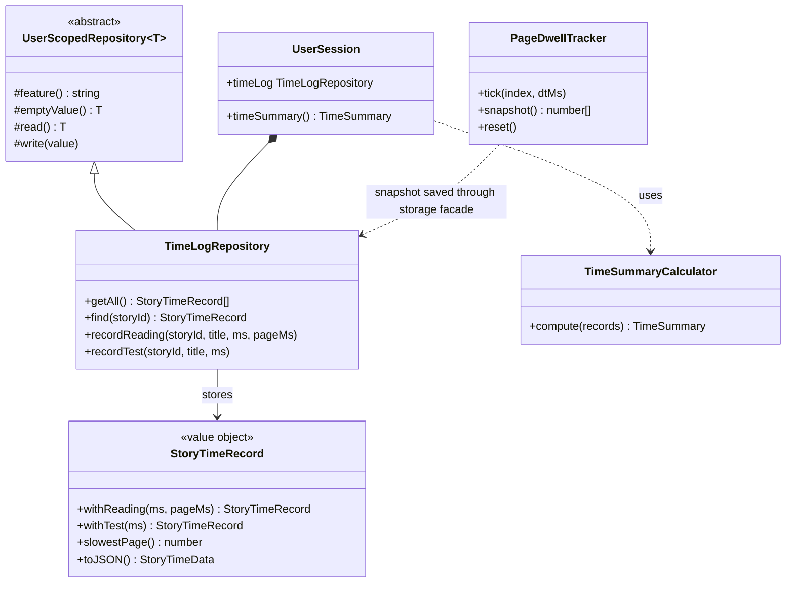

# Time analysis (profile → Time spent)

कोई व्यक्ति पढ़ने और test देने में कितना समय बिताता है, story-by-story और page-by-page। यह [OOP_ARCHITECTURE.md](OOP_ARCHITECTURE.md) में बताई गई per-user session layer पर बना है, इसलिए हर संख्या ठीक एक user की होती है और accounts के बीच कुछ leak नहीं होता।

## Profile क्या दिखाता है

| कहाँ | क्या |
| --- | --- |
| पाँच cards | कुल समय, पढ़ने का समय, testing का समय, documentation का समय, stories की संख्या |
| Documentation, page by page | आपके खोले हर documentation page का: बिताया समय, visits और आख़िरी visit, सबसे लंबा पहले |
| Story by story | पढ़ने का समय, test का समय, sessions, आख़िरी गतिविधि, और पढ़ने व testing को बाँटने वाला एक bar |
| कोई story खोलें | Page-by-page bars (लगभग 250 words प्रति page, या upload की गई PDF या image story का असली page) जिसमें सबसे लंबा page लाल रंग में होता है |

Tab **Profile → Time spent** है, Analytics के बगल में।

## क्या record होता है, और कब

| Event | किसने लिखा | Record |
| --- | --- | --- |
| Reading mode में पढ़ना (story page और `/read`) | `ReadingModePage` | असली दिखाई देने वाला पढ़ने का समय, साथ में प्रति page समय। *Finished* दबाने पर, या page छोड़ने पर save होता है |
| Auto-scroll reader से पढ़ना | `app/reader/page.tsx` | story पूरी होने पर कुल समय (breaks घटाकर)। कोई page detail नहीं, क्योंकि page अपने-आप scroll होता है |
| एक test | `app/results/page.tsx` | पूरे test की अवधि, हर result पर एक बार |
| एक documentation page | हर docs page पर `DocTimeTracker` | वह समय जब page दिख रहा हो और पिछले 2 मिनट में कुछ गतिविधि हुई हो, page छोड़ने, tab छिपाने या बंद करने पर save होता है; 3 सेकंड से छोटी visits को अनदेखा किया जाता है |

संख्याओं को ईमानदार रखने वाले नियम:

- **सिर्फ़ असली समय।** Tab छिपे होने पर या article के screen पर न होने पर clock रुक जाती है।
- **Reading line के नीचे वाला page।** हर 250 ms पर बीता हुआ हिस्सा viewport की ऊँचाई के 40% पर मौजूद page में जोड़ा जाता है, यह वही reading line है जो progress bar इस्तेमाल करता है।
- **छोटी visits हटा दी जाती हैं।** 3 सेकंड से कम की reading log नहीं होती, ताकि story खोलने और बंद करने से totals गंदे न हों।
- **एक बार save।** एक flag save की रक्षा करता है, इसलिए *Finished* के बाद page के unmount होने पर दो बार नहीं गिना जाता।

## Documentation के लिए sign-in ज़रूरी है

Notes और docs pages (जिन्हें QR code खोलता है) अब public नहीं हैं: जो भी उन्हें खोलता है वह पहले sign in करता है, और फिर page देखता है। इसी से documentation की reading किसी व्यक्ति के नाम दर्ज हो पाती है। Pages अपना header और footer रखते हैं; सिर्फ़ login gate बदला है (`DevLoginGate`)।

## Class diagram



## OOP principles, कहाँ दिखते हैं

| Principle | कहाँ |
| --- | --- |
| Encapsulation | `StoryTimeRecord` अपना data getters के पीछे छिपाता है; `TimeLogRepository` ही अकेला code है जो stored JSON को पढ़ता या लिखता है |
| Abstraction | UI `session.timeSummary()` और `timeLog.getAll()` माँगता है, keys या JSON कभी नहीं |
| Inheritance | `TimeLogRepository extends UserScopedRepository`, इसलिए key building, safe parsing और fall-backs base से आते हैं |
| Polymorphism | `UserSession.clearAllData()` साझा base type के ज़रिए time log को बाकियों के साथ clear करता है |
| Composition | `UserSession` repository और calculator को compose करता है; दोनों tests में बदले जा सकते हैं |
| Immutability | `StoryTimeRecord.with…` नया record लौटाता है, इसलिए stored row caller के नीचे कभी बदल नहीं सकती |
| Single responsibility | Tracker सिर्फ़ गिनता है, record सिर्फ़ merge करता है, repository सिर्फ़ store करती है, calculator सिर्फ़ जोड़ता है, panel सिर्फ़ draw करता है |

```ts title="lib/session/repositories/TimeLogRepository.ts" principle="Inheritance + encapsulation: उपवर्ग बताता है कि क्या store करना है; storage का काम base करता है"
export class TimeLogRepository extends UserScopedRepository<Record<string, StoryTimeData>> {
  static readonly MIN_MS = 3000;

  protected feature(): string {
    return "timelog";
  }

  recordReading(storyId: string, title: string, ms: number, pageMs: readonly number[] = []): void {
    if (ms < TimeLogRepository.MIN_MS) return;   // ignore accidental opens
    this.save((this.find(storyId) ?? StoryTimeRecord.empty(storyId, title)).withReading(ms, pageMs, title));
  }
}
```

```ts title="lib/readingMode/PageDwellTracker.ts" principle="Pure logic, कोई DOM नहीं: pages block positions से आते हैं, इसलिए इसे browser के बिना unit-test किया जाता है"
export function pageIndexAt(y: number, starts: number[]): number {
  if (starts.length === 0) return 0;
  let lo = 0;
  let hi = starts.length - 1;
  while (lo < hi) {
    const mid = (lo + hi + 1) >> 1;
    if (starts[mid] <= y) lo = mid;
    else hi = mid - 1;
  }
  return lo;
}
```

## Files

| File | भूमिका |
| --- | --- |
| `lib/readingMode/PageDwellTracker.ts` | `paginate`, `pageIndexAt`, `PageDwellTracker` |
| `lib/session/analytics/StoryTimeRecord.ts` | Immutable per-story record |
| `lib/session/repositories/TimeLogRepository.ts` | Per-user storage (`timelog` slot) |
| `lib/session/analytics/DocTimeRecord.ts`, `lib/session/repositories/DocTimeRepository.ts` | प्रति documentation page समय (`doctime` slot) |
| `components/Notes/DocTimeTracker.tsx` | Docs page पर असली reading time मापता है |
| `lib/session/analytics/TimeSummaryCalculator.ts` | Totals, documentation सहित |
| `lib/session/UserSession.ts` | Repository को compose करता है; `timeSummary()` |
| `lib/storage.ts` | Facade methods `recordStoryReading`, `recordStoryTest` |
| `components/Profile/TimeAnalysisPanel.tsx` | *Time spent* tab |
| `scripts/timelog.test.ts` | Tests (`npm run test:timelog`) |

## सीमाएँ

- Data इस browser के storage में रहता है, session layer के बाकी हिस्सों की तरह। Backend आने तक कोई दूसरा device इसे नहीं देखता।
- Auto-scroll reader सिर्फ़ कुल समय record करता है।
- Page की सीमाएँ word counts का पालन करती हैं, इसलिए text size बदलने से यह नहीं बदलता कि कौन-से words किस page के हैं।
