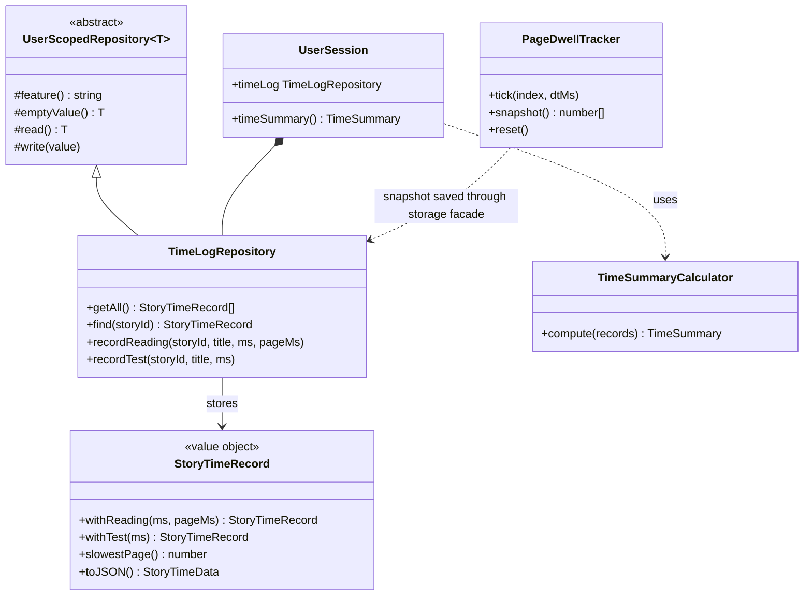

# Time analysis (profile → Time spent)

How much time a person spends reading and testing, story by story and page by page. It is built on the per-user session layer described in [OOP_ARCHITECTURE.md](OOP_ARCHITECTURE.md), so every number belongs to exactly one user and nothing leaks between accounts.

## What the profile shows

| Where | What |
| --- | --- |
| Five cards | Total time, reading time, testing time, documentation time, number of stories |
| Documentation, page by page | Every documentation page you opened: time spent, visits and last visit, longest first |
| Story by story | Reading time, test time, sessions, last activity, and a bar splitting reading from testing |
| Open a story | Page-by-page bars (about 250 words per page, or the real page of an uploaded PDF or image story) with the longest page in red |

The tab is **Profile → Time spent**, next to Analytics.

## What is recorded, and when

| Event | Written by | Recorded |
| --- | --- | --- |
| Reading in reading mode (the story page and `/read`) | `ReadingModePage` | Real visible reading time, plus time per page. Saved when you press *Finished*, or when you leave the page |
| Reading with the auto-scroll reader | `app/reader/page.tsx` | Total time (minus breaks) when the story completes. No page detail, because the page scrolls by itself |
| A test | `app/results/page.tsx` | The whole test duration, once per result |
| A documentation page | `DocTimeTracker` on every docs page | Time with the page visible and some activity in the last 2 minutes, saved when you leave, hide the tab or close it; visits under 3 seconds are ignored |

Rules that keep the numbers honest:

- **Only real time.** The clock stops while the tab is hidden or while the article is not on screen.
- **Page under the reading line.** Every 250 ms the elapsed slice is added to the page at 40% of the viewport height, the same reading line the progress bar uses.
- **Short visits are dropped.** A reading under 3 seconds is not logged, so opening and closing a story does not pollute the totals.
- **Saved once.** A flag guards the save, so *Finished* followed by the page unmounting does not count twice.

## Documentation needs a sign-in

The notes and docs pages (the ones a QR code opens) are no longer public: anyone who opens them signs in first, and then sees the page. That is what lets documentation reading be attributed to a person. The pages keep their own header and footer; only the login gate changed (`DevLoginGate`).

## Class diagram



## OOP principles, where they show up

| Principle | Where |
| --- | --- |
| Encapsulation | `StoryTimeRecord` hides its data behind getters; `TimeLogRepository` is the only code that reads or writes the stored JSON |
| Abstraction | The UI asks `session.timeSummary()` and `timeLog.getAll()`, never for keys or JSON |
| Inheritance | `TimeLogRepository extends UserScopedRepository`, so key building, safe parsing and fall-backs come from the base |
| Polymorphism | `UserSession.clearAllData()` clears the time log with the others through the shared base type |
| Composition | `UserSession` composes the repository and the calculator; both can be swapped in tests |
| Immutability | `StoryTimeRecord.with…` returns a new record, so a stored row can never change under a caller |
| Single responsibility | The tracker only counts, the record only merges, the repository only stores, the calculator only sums, the panel only draws |

```ts title="lib/session/repositories/TimeLogRepository.ts" principle="Inheritance + encapsulation: the subclass says what it stores; the base does the storage work"
export class TimeLogRepository extends UserScopedRepository<Record<string, StoryTimeData>> {
  static readonly MIN_MS = 3000;

  protected feature(): string {
    return "timelog";
  }

  recordReading(storyId: string, title: string, ms: number, pageMs: readonly number[] = []): void {
    if (ms < TimeLogRepository.MIN_MS) return;   // ignore accidental opens
    this.save((this.find(storyId) ?? StoryTimeRecord.empty(storyId, title)).withReading(ms, pageMs, title));
  }
}
```

```ts title="lib/readingMode/PageDwellTracker.ts" principle="Pure logic, no DOM: pages come from block positions, so it is unit-tested without a browser"
export function pageIndexAt(y: number, starts: number[]): number {
  if (starts.length === 0) return 0;
  let lo = 0;
  let hi = starts.length - 1;
  while (lo < hi) {
    const mid = (lo + hi + 1) >> 1;
    if (starts[mid] <= y) lo = mid;
    else hi = mid - 1;
  }
  return lo;
}
```

## Files

| File | Role |
| --- | --- |
| `lib/readingMode/PageDwellTracker.ts` | `paginate`, `pageIndexAt`, `PageDwellTracker` |
| `lib/session/analytics/StoryTimeRecord.ts` | Immutable per-story record |
| `lib/session/repositories/TimeLogRepository.ts` | Per-user storage (`timelog` slot) |
| `lib/session/analytics/DocTimeRecord.ts`, `lib/session/repositories/DocTimeRepository.ts` | Time per documentation page (`doctime` slot) |
| `components/Notes/DocTimeTracker.tsx` | Measures real reading time on a docs page |
| `lib/session/analytics/TimeSummaryCalculator.ts` | Totals, documentation included |
| `lib/session/UserSession.ts` | Composes the repository; `timeSummary()` |
| `lib/storage.ts` | Facade methods `recordStoryReading`, `recordStoryTest` |
| `components/Profile/TimeAnalysisPanel.tsx` | The *Time spent* tab |
| `scripts/timelog.test.ts` | Tests (`npm run test:timelog`) |

## Limits

- Data lives in this browser's storage, like the rest of the session layer. Another device does not see it until there is a backend.
- The auto-scroll reader records a total only.
- Page boundaries follow word counts, so changing the text size does not change which words belong to a page.
