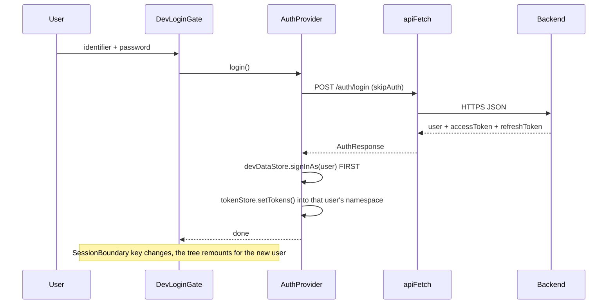
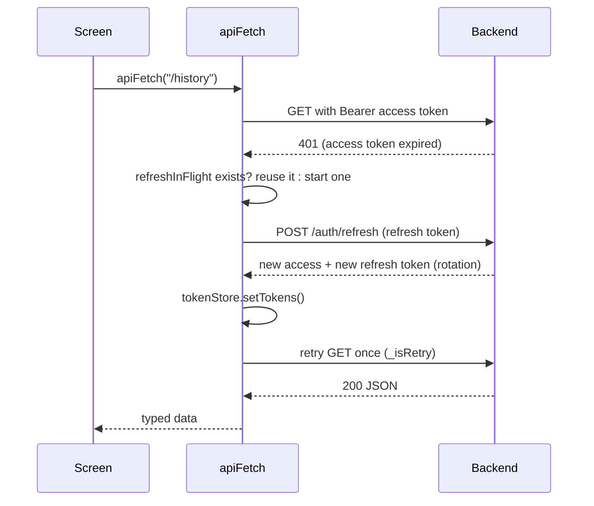
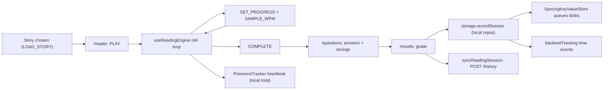

# Data flows

नीचे का हर flow code का असली रास्ता है, कदम-दर-कदम, और हर कदम करने वाली file के साथ। अगर आप इन्हें याद से बना सकते हैं, तो "अपना project समझाइए" वाले ज़्यादातर सवालों का जवाब दे सकते हैं।

## 1. App शुरू होना और session वापस लाना

1. Browser वह HTML load करता है जो Next.js ने server पर render किया। `DevLoginGate` पहले एक खाली screen दिखाता है (`ready = false`), ताकि server का HTML और client का पहला render एक जैसे हों (hydration mismatch नहीं)।
2. सिर्फ़ client पर चलने वाला effect `devDataStore.hydrate()` बुलाता है: यह `localStorage` से `speed-reader:dev-store:v1` पढ़ता है और social data व याद रखा गया user id वापस लाता है।
3. `AuthProvider` `pingBackend()` (`GET /api/v1/health`) बुलाता है। Free-tier का सोया हुआ server व्यक्ति के कुछ लिखने से पहले ही जागना शुरू कर देता है।
4. अगर कोई user id वापस आया, तो `AuthProvider` उस user के रखे हुए access token के साथ `GET /auth/me` से उसे दोबारा जाँचता है।
   - वही id के साथ `200`: session सही है।
   - `401`, या `ACCOUNT_*` code के साथ `403`: tokens हटाए जाते हैं और व्यक्ति sign out हो जाता है।
   - Network error: session बना रहता है और अगले load पर फिर जाँचा जाता है (किसी outage से लोग log out नहीं होने चाहिए)।
   - अलग id: tokens किसी और के हैं, इसलिए सब कुछ साफ़ किया जाता है।
5. `DevLoginGate` sign-in किए हुए user के लिए `backendSync` शुरू करता है (section 6)।

## 2. Password से sign-in

क्रम क्यों ज़रूरी है: tokens active user के namespace में रखे जाते हैं, इसलिए tokens लिखने से पहले user को "current" बनना होगा, वरना वे पिछले user के slot में चले जाएँगे।

अगर backend तक पहुँच नहीं हुई (status 0, 5xx, या कोई URL set नहीं) और credentials किसी built-in demo व्यक्ति से मिलते हैं, तो बिना tokens वाला offline demo session शुरू होता है। अगर backend ने जवाब दिया (जैसे गलत password), तो वही जवाब अंतिम है।

## 3. Google से sign-in

1. `SocialButtons` `https://accounts.google.com/gsi/client` load करता है और `NEXT_PUBLIC_GOOGLE_CLIENT_ID` के साथ Google का button दिखाता है।
2. Google पेज को एक signed **ID token** (एक JWT) लौटाता है।
3. `AuthProvider.google(idToken)` उसे `POST /auth/google` पर भेजता है। Backend Google की public keys से signature, audience (client id) और expiry जाँचता है, फिर account ढूँढता या बनाता है।
4. नए accounts को admin की मंज़ूरी चाहिए हो सकती है (`approvalRequired`); वरना `establish()` बिल्कुल password sign-in जैसा चलता है।

यह सब port 443 पर HTTPS है, इसलिए उन hosts पर भी चलता है जो बाहर जाने वाला SMTP रोकते हैं। ऐसे hosts पर e-mail OTP flows (verify, reset) के लिए HTTPS से पहुँचने वाला e-mail provider चाहिए।

## 4. Sign-up, e-mail verification और password reset

- `POST /auth/signup` या तो session लौटाता है, या `verificationRequired` (OTP e-mail हुआ), या `approvalRequired`।
- Gate `verify-otp` mode में चला जाता है; `POST /auth/verify-email-otp` 6 अंकों का code पक्का करता है।
- Password भूल गए: `POST /auth/forgot-password` code और link भेजता है; `POST /auth/reset-password-otp` (code) या `/reset-password` (link token) नया password set करता है।
- E-mail के links `/verify-email` या `/reset-password` को बिना sign-in खोलते हैं: inbox का मालिक होना ही सबूत है।

## 5. हर API call और token refresh

- **Single-flight**: एक साथ fail होने वाले दस requests एक ही refresh promise साझा करते हैं। इसके बिना दस refreshes एक ही refresh token को rotate करने की होड़ करते और server की reuse detection session रद्द कर देती।
- **सिर्फ़ एक retry** (`_isRetry`) अनंत loop रोकता है।
- `403 ACCOUNT_BANNED` या `ACCOUNT_REJECTED` tokens हटाकर sign-in screen पर reload करता है।
- हर विफलता `status`, `code` और `details` वाला `ApiError` बनती है, ताकि screens field के errors दिखा सकें।

## 6. Social action: story like करना, लेखक को notification मिलना

1. `ContentActions` `devDataStore.setReaction(contentId, userId, "like")` बुलाता है।
2. Store हर `(contentId, userId)` के लिए एक reaction row **upsert** करता है (code में लिखा uniqueness नियम)। अगर यह नया like है, तो story के लेखक के लिए notification भी बनाता है, खुद के लिए कभी नहीं।
3. `touch()` store का version बढ़ाता है (`useSyncExternalStore` से subscribe किया हर component दोबारा render होता है), पूरा snapshot `localStorage` में save करता है, और `onLocalChange` चलाता है।
4. `backendSync.schedulePush()` 400 ms रुकता है (debounce: जल्दी-जल्दी किए clicks एक request बनते हैं)।
5. `push()` मौजूदा records की तुलना **baseline** से करता है (जो server के पास पहले से है)। User के अपने नए या बदले records `put` ops बनते हैं, गायब records `delete` ops (tombstones)। Ops 200 के batches में `POST /sync/ops` पर जाते हैं; server मालिकाना हक़ दोबारा जाँचता है।
6. लेखक का browser हर 15 s पर और tab दिखने पर `GET /sync/snapshot?since=<seq>` poll करता है। Snapshot में उस sequence number के बाद के upserts और deletes होते हैं। `applyServerSnapshot()` उन्हें **वापस भेजे बिना** मिला देता है (`touchQuiet`)।
7. `NotificationBell` store से दोबारा render होता है और unread badge दिखाता है।

लेखक के लिए देरी: 15 s तक (polling)। Push stream के लिए SSE hook `useNotificationStream` मौजूद है; उसे `NotificationBell` में mount करने से यह लगभग तुरंत हो जाएगा।

## 7. Reading session: Play से history में दर्ज होने तक

1. `LOAD_STORY` story को reading reducer में डालता है।
2. Engine (`hooks/useReadingEngine.ts`) `requestAnimationFrame` पर चलता है। हर frame: `progress += dt / duration`, जहाँ `duration = words / WPM`। Scroll की जगह **निकाली** जाती है `progress * (scrollHeight - viewportHeight)` से, इसलिए font size बदलने पर प्रतिशत कभी नहीं उछलता।
3. `(time, words)` samples की 4 सेकंड की चलती खिड़की speedometer के लिए live WPM देती है।
4. छिपा हुआ tab अपने आप रुक जाता है (`useAutoPause`); breaks `useBreakTracker` गिनता है।
5. `progress = 1` पर reducer `completed` में जाता है, फिर सवालों पर। हर जवाब अपना समय दर्ज करता है।
6. `/results` `lib/grading.ts` से grade करता है, `storage.*` (session repositories) से history, daily activity, streak और time log लिखता है, और `syncReadingSession()` बुलाता है (भेजो और भूल जाओ वाला `POST /history`)।
7. Repository की हर write `SyncingKeyValueStore` से गुज़रती है, जो नया blob `PUT /tracking/blobs/<feature>` के लिए queue में डालता है।

## 8. पढ़ने का समय और presence

1. `PresenceTracker` scroll, key, pointer और touch events और tab की visibility सुनता है, और हर 5 s पर `heartbeat()` बुलाता है।
2. समय तभी जुड़ता है जब user पढ़ने वाली surface पर हो, tab दिख रहा हो, और पिछले 60 s में कोई गतिविधि हुई हो। एक beat ज़्यादा से ज़्यादा 10 s जोड़ सकती है, ताकि सोया हुआ laptop घंटे न जोड़ दे। यह चलता हुआ कुल समय इसी browser में हर user के लिए रखा जाता है और "अभी पढ़ रहे हैं" वाला dot चलाता है।
3. अलग से, जब `storage.*` facade से किसी story के पढ़ने या test का समय, या किसी doc पेज का समय दर्ज होता है, तो वह `backendTracking.trackTime(...)` और `trackCount(...)` भी बुलाता है। हर event का एक unique `opId` होता है, वह `localStorage` में queue होता है (`srt:track:q:<userId>`, अधिकतम 2,000), और 3 s बाद 100 के batches में `POST /tracking/events` पर भेजा जाता है।
4. Server पहले से रखे `opId` को नज़रअंदाज़ करता है, इसलिए खोए जवाब के बाद retry कभी दो बार नहीं गिना जाता। यह **idempotent receiver के साथ at-least-once delivery** है, जो exactly-once जैसा असर देती है।
5. Tab छिपने पर queue तुरंत flush होती है।

## 9. नए device पर पहला sign-in

1. `backendSync.start()` flag `srt:sync:init:<userId>` देखता है। Set नहीं है मतलब इस browser ने कभी link नहीं किया।
2. पहला link: इस browser के पास जो है वह push करो, फिर snapshot pull करो।
3. `restoreReadingData()` `GET /tracking/state` बुलाता है और हर feature के लिए `SyncingKeyValueStore.reconcile()` चलाता है:
   - इस browser के पास असली data है: उसे upload करो;
   - इस browser के पास कुछ नहीं पर server के पास है: उसे local में लिखो।
4. अगर कुछ भी वापस आया, तो पेज reload होता है ताकि हर repository वापस आया data पढ़े। फिर flag set हो जाता है ताकि यह एक ही बार हो।

## 10. पढ़ने के लिए PDF या images upload करना

1. `SearchBar` / `AddStoryModal` file picker से files लेते हैं (पेज को कभी file path नहीं दिखता: browser sandbox)।
2. `lib/mediaStory.ts` pdf.js से पन्ने render करता है (worker thread `/pdf.worker.min.mjs` पर) या images पढ़ता है, word count का अनुमान लगाता है, और paragraphs की जगह `media` object वाला `StoryData` बनाता है।
3. वही reading engine, controls और timing बिना बदले चलते हैं क्योंकि WPM का गणित `storyWordCount()` इस्तेमाल करता है, जो media का अनुमान पढ़ता है।
4. Flip book के लिए files memory में सौंपी जाती हैं (`lib/flipreader/handoff.ts`) और `/flipbook` उन्हें खोलता है; निकाला गया text IndexedDB में cache होता है।

## 11. Search और feed

- **Story search** (`lib/storyLibrary.ts`): title, description, level, difficulty और tags पर छोटे अक्षरों में substring मिलान; ऊपर के 8 दिखते हैं। Arrow keys results में चलती हैं; Enter पहला मिलान खोलता है; शब्द per-user search history में जाते हैं।
- **Feed** (`lib/devData/contentMeta.ts`): stories को इस आधार पर अंक मिलते हैं कि उनके कितने topics user की रुचियों से मिलते हैं, फिर stable sort होता है, इसलिए बराबरी वाले अपना मूल क्रम रखते हैं। `PersonalizedFeed` एक बार में 6 दिखाता है और sentinel दिखने पर और load करता है।
- **Docs search**: section स्तर का index (`lib/docs/search.generated.ts`) build के समय बनता है और search box इस्तेमाल होने पर ही load होता है।

## 12. Docs site: Markdown से पेज तक

1. `node scripts/build-docs.mjs` `docs/` में घूमता है, `::include` lines फैलाता है (code अलग files में रखा जाता है), हर `x.md` को `x.hi.md` से जोड़ता है, और तीन bundles लिखता है: पूरे docs, menu के लिए titles का index, और search index।
2. `/notes/[userId]/docs/[slug]` doc ढूँढता है, अपने renderer से Markdown render करता है (पहले सब कुछ HTML-escape होता है, `javascript:` links हटाए जाते हैं), और अंग्रेज़ी व हिंदी HTML `DocContent` को देता है।
3. हिंदी headings अंग्रेज़ी ids दोबारा इस्तेमाल करती हैं, इसलिए `#section` links दोनों भाषाओं में चलते हैं।
4. `DocTimeTracker` हर doc पेज पर बिताया समय दर्ज करता है।

## 13. Health check और backend status toast

Sign-in screen पर `AuthCard` हर load पर एक बार `GET /api/v1/health` बुलाता है। `{ "status": "ok" }` आने पर 3 s के लिए "Backend connected" दिखता है; कोई error या दूसरा जवाब आने पर "Backend not connected" दिखता है।
