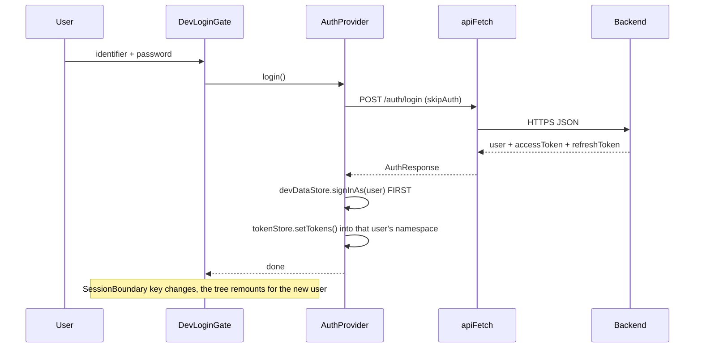
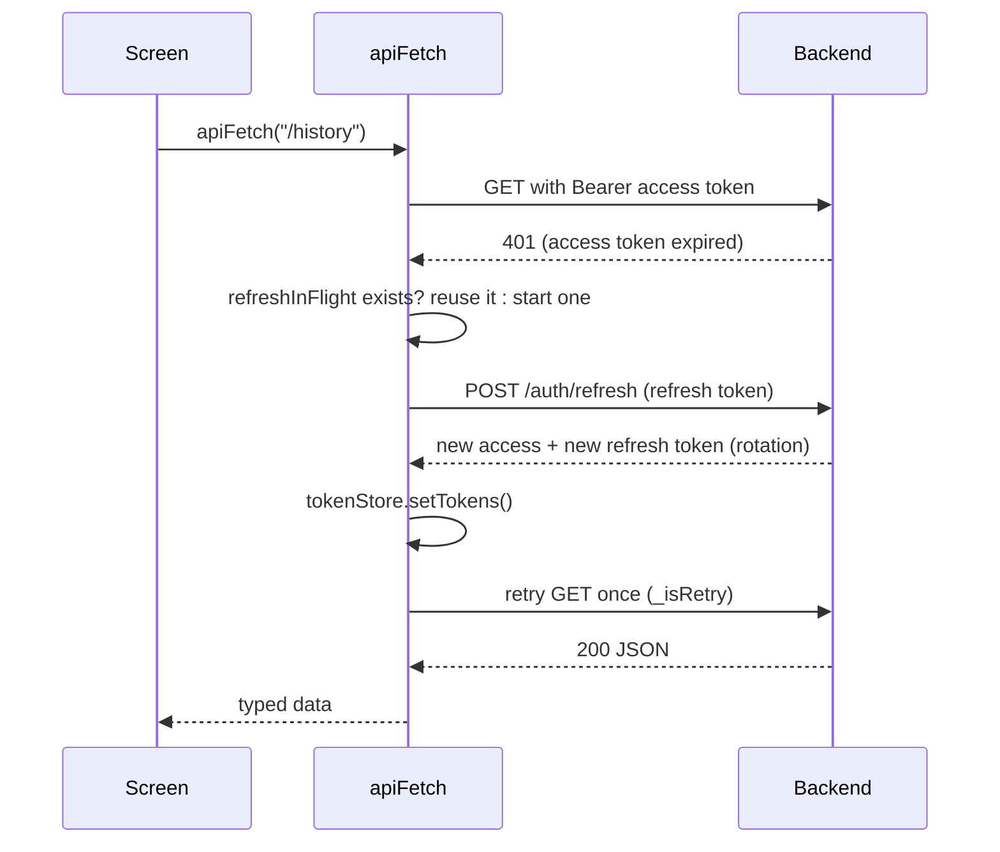
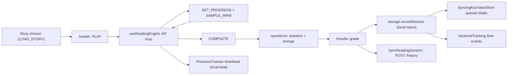

# Data flows

Each flow below is a real path through the code, step by step, with the file that does each step. If you can draw these from memory, you can answer most "walk me through your project" questions.

## 1. App start and session restore

1. The browser loads the HTML that Next.js rendered on the server. `DevLoginGate` first paints an empty screen (`ready = false`), so the server HTML and the first client render match (no hydration mismatch).
2. A client-only effect calls `devDataStore.hydrate()`: it reads `speed-reader:dev-store:v1` from `localStorage` and restores social data and the remembered user id.
3. `AuthProvider` calls `pingBackend()` (`GET /api/v1/health`). A free-tier server that was asleep starts waking up before the person types anything.
4. If a user id was restored, `AuthProvider` re-checks it with `GET /auth/me` using that user's stored access token.
   - `200` with the same id: the session is valid.
   - `401`, or `403` with an `ACCOUNT_*` code: tokens are cleared and the person is signed out.
   - Network error: the session is kept and checked again next load (an outage should not log people out).
   - A different id: tokens belong to someone else, so everything is cleared.
5. `DevLoginGate` starts `backendSync` for the signed-in user (section 6).

## 2. Sign-in with password

Why the order matters: tokens are stored under the active user's namespace, so the user must become "current" before the tokens are written, otherwise they would land in the previous user's slot.

If the backend could not be reached (status 0, 5xx, or no URL configured) and the credentials match a built-in demo person, an offline demo session starts with no tokens. If the backend answered (for example wrong password), that answer is final.

## 3. Sign-in with Google

1. `SocialButtons` loads `https://accounts.google.com/gsi/client` and renders Google's button with `NEXT_PUBLIC_GOOGLE_CLIENT_ID`.
2. Google returns a signed **ID token** (a JWT) to the page.
3. `AuthProvider.google(idToken)` sends it to `POST /auth/google`. The backend verifies the signature with Google's public keys, the audience (client id) and expiry, then finds or creates the account.
4. New accounts may need admin approval (`approvalRequired`); otherwise `establish()` runs exactly as in password sign-in.

All of this is HTTPS on port 443, so it works on hosts that block outbound SMTP. E-mail OTP flows (verify, reset) need an e-mail provider reachable over HTTPS on such hosts.

## 4. Sign-up, e-mail verification and password reset

- `POST /auth/signup` returns either a session, or `verificationRequired` (an OTP was e-mailed), or `approvalRequired`.
- The gate switches to `verify-otp` mode; `POST /auth/verify-email-otp` confirms the 6-digit code.
- Forgot password: `POST /auth/forgot-password` sends a code and link; `POST /auth/reset-password-otp` (code) or `/reset-password` (link token) sets the new password.
- Links in e-mails open `/verify-email` or `/reset-password` without a sign-in: owning the inbox is the proof.

## 5. Every API call and the token refresh

- **Single-flight**: ten requests failing at once share one refresh promise. Without it, ten refreshes would race to rotate the same refresh token and the server's reuse detection would revoke the session.
- **One retry only** (`_isRetry`) prevents an infinite loop.
- A `403 ACCOUNT_BANNED` or `ACCOUNT_REJECTED` clears tokens and reloads to the sign-in screen.
- Every failure becomes an `ApiError` with `status`, `code` and `details`, so screens can show field errors.

## 6. Social action: like a story, the author gets a notification

1. `ContentActions` calls `devDataStore.setReaction(contentId, userId, "like")`.
2. The store **upserts** one reaction row per `(contentId, userId)` (a uniqueness rule written in code). If this is a new like, it also creates a notification for the story's author, never for yourself.
3. `touch()` bumps the store version (every subscribed component re-renders through `useSyncExternalStore`), saves the whole snapshot to `localStorage`, and fires `onLocalChange`.
4. `backendSync.schedulePush()` waits 400 ms (debounce: a burst of clicks becomes one request).
5. `push()` diffs current records against the **baseline** (what the server already has). New or changed records the user owns become `put` ops, missing ones become `delete` ops (tombstones). Ops go to `POST /sync/ops` in batches of 200; the server re-checks ownership.
6. The author's browser polls `GET /sync/snapshot?since=<seq>` every 15 s and when its tab becomes visible. The snapshot holds upserts and deletes after that sequence number. `applyServerSnapshot()` merges them **without** echoing them back (`touchQuiet`).
7. `NotificationBell` re-renders from the store and shows the unread badge.

Latency for the author: up to 15 s (polling). The SSE hook `useNotificationStream` exists for a push stream; mounting it in `NotificationBell` would make this near-instant.

## 7. Reading session: from Play to stored history

1. `LOAD_STORY` puts the story into the reading reducer.
2. The engine (`hooks/useReadingEngine.ts`) runs on `requestAnimationFrame`. Each frame: `progress += dt / duration`, where `duration = words / WPM`. The scroll position is **derived** as `progress * (scrollHeight - viewportHeight)`, so changing the font size never makes the percentage jump.
3. A 4-second rolling window of `(time, words)` samples gives the live WPM for the speedometer.
4. A hidden tab auto-pauses (`useAutoPause`); breaks are counted by `useBreakTracker`.
5. At `progress = 1` the reducer moves to `completed`, then to questions. Each answer records its own time.
6. `/results` grades with `lib/grading.ts`, writes history, daily activity, streak and time log through `storage.*` (the session repositories), and calls `syncReadingSession()` (fire-and-forget `POST /history`).
7. Each repository write passes through `SyncingKeyValueStore`, which queues the new blob for `PUT /tracking/blobs/<feature>`.

## 8. Reading time and presence

1. `PresenceTracker` listens for scroll, key, pointer and touch events and for tab visibility, and calls `heartbeat()` every 5 s.
2. Time is added only if the user is on a reading surface, the tab is visible, and there was activity in the last 60 s. One beat can add at most 10 s, so a sleeping laptop cannot add hours. This running total is kept per user in this browser and drives the "reading now" dot.
3. Separately, when a story's reading or test time, or a doc page's time, is recorded through the `storage.*` facade, it also calls `backendTracking.trackTime(...)` and `trackCount(...)`. Each event has a unique `opId`, is queued in `localStorage` (`srt:track:q:<userId>`, capped at 2,000), and is flushed 3 s later in batches of 100 to `POST /tracking/events`.
4. The server ignores an `opId` it has already stored, so a retry after a lost response never counts twice. This is **at-least-once delivery with an idempotent receiver**, which gives an exactly-once effect.
5. On tab hide the queue is flushed immediately.

## 9. First sign-in on a new device

1. `backendSync.start()` checks the flag `srt:sync:init:<userId>`. Not set means this browser has never linked.
2. First link: push what this browser has, then pull the snapshot.
3. `restoreReadingData()` calls `GET /tracking/state` and runs `SyncingKeyValueStore.reconcile()` per feature:
   - this browser has real data: upload it;
   - this browser has nothing but the server has data: write it locally.
4. If anything was restored, the page reloads so every repository reads the restored data. The flag is then set so this happens once.

## 10. Uploading a PDF or images to read

1. `SearchBar` / `AddStoryModal` receive files from the file picker (the page never sees a file path: browser sandbox).
2. `lib/mediaStory.ts` renders pages with pdf.js (worker thread at `/pdf.worker.min.mjs`) or reads images, estimates a word count, and builds a `StoryData` with a `media` object instead of paragraphs.
3. The same reading engine, controls and timing run unchanged because WPM math uses `storyWordCount()`, which reads the media's estimate.
4. For the flip book, files are handed over in memory (`lib/flipreader/handoff.ts`) and opened by `/flipbook`; extracted text is cached in IndexedDB.

## 11. Search and feed

- **Story search** (`lib/storyLibrary.ts`): lower-cased substring match over title, description, level, difficulty and tags; top 8 shown. Arrow keys move through results; Enter opens the first match; terms go to per-user search history.
- **Feed** (`lib/devData/contentMeta.ts`): stories are scored by how many of their topics match the user's interests, then stably sorted, so ties keep their original order. `PersonalizedFeed` shows 6 at a time and loads more when a sentinel scrolls into view.
- **Docs search**: a section-level index (`lib/docs/search.generated.ts`) built at build time and loaded only when the search box is used.

## 12. Docs site: from Markdown to page

1. `node scripts/build-docs.mjs` walks `docs/`, expands `::include` lines (code kept in separate files), pairs every `x.md` with `x.hi.md`, and writes three bundles: full docs, a title index for the menu, and a search index.
2. `/notes/[userId]/docs/[slug]` finds the doc, renders Markdown with the in-house renderer (everything is HTML-escaped first, `javascript:` links dropped), and passes English and Hindi HTML to `DocContent`.
3. Hindi headings reuse the English ids, so `#section` links work in both languages.
4. `DocTimeTracker` records time spent on each doc page.

## 13. Health check and backend status toast

On the sign-in screen, `AuthCard` calls `GET /api/v1/health` once per load. `{ "status": "ok" }` shows "Backend connected" for 3 s; any error or other answer shows "Backend not connected".
