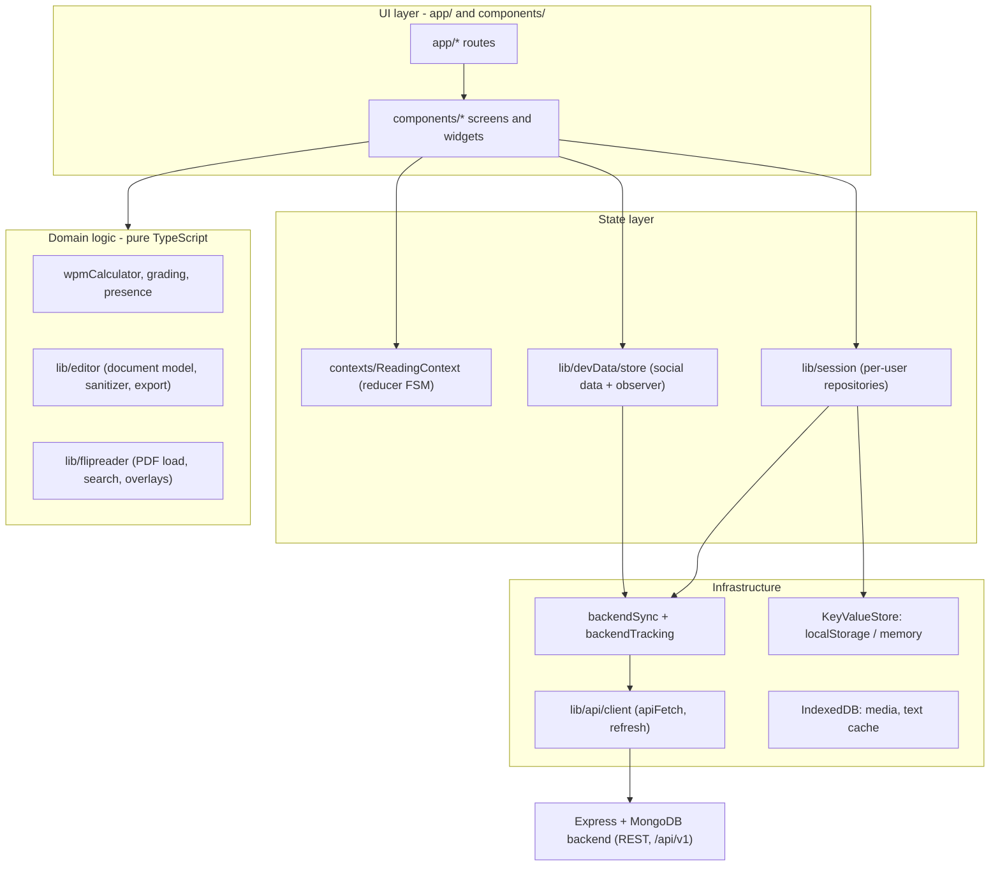

# आर्किटेक्चर ओवरव्यू

पूरा Pacewise frontend एक पेज पर: layers कौन-सी हैं, कौन-सा folder किस चीज़ का मालिक है, और आगे क्या पढ़ना है। यहाँ की हर बात इसी repository के असली code की ओर इशारा करती है (लगभग 43,000 हाथ से लिखी lines, करीब 320 files में)।

## 1. एक पैराग्राफ़ में प्रोडक्ट

Pacewise पढ़ने की प्रैक्टिस का प्लेटफ़ॉर्म है। व्यक्ति sign in करता है, कोई story चुनता या upload करता है (text, PDF या images), उसे चुनी हुई speed पर पढ़ता है (auto-scroll reader, free-scroll reading mode या पन्ने पलटने वाली flip book), quiz देता है, और फिर results, streaks, calendar और समय के analytics देखता है। इसके ऊपर social features हैं (like, dislike, comment, share, follow, playlists, notifications), एक rich-text editor, export वाला PDF flip-book editor, QR से share होने वाले public notes, और यह documentation site जिसमें अंग्रेज़ी और हिंदी दोनों पेज हैं। Frontend **Next.js 14 (App Router) + React 18 + TypeScript (strict)** पर बना है और एक अलग Express + MongoDB backend से REST के ज़रिए बात करता है।

## 2. Layers

| Layer | Folder | कौन-सा नियम मानती है |
|---|---|---|
| Routes | `app/` | पतली: page file बस एक screen component चुनती है और route params देती है। कोई business logic नहीं। |
| Screens और widgets | `components/` | Feature के हिसाब से समूह (`Auth`, `Search`, `FlipReader`, `Editor`, `Notes` ...)। State hooks से पढ़ते हैं, `localStorage` को सीधे कभी नहीं छूते। |
| पूरे app की state | `contexts/`, `lib/devData/`, `lib/session/` | हर तरह की state का एक ही मालिक। React `useReducer` या `useSyncExternalStore` से subscribe करता है। |
| Domain logic | `lib/editor/`, `lib/flipreader/`, `lib/*.ts` | सादा TypeScript, React नहीं, `scripts/*.test.ts` में unit-tested। |
| Infrastructure | `lib/api/`, `lib/session/storage/` | सिर्फ़ यही code HTTP, tokens, `localStorage` और IndexedDB के बारे में जानता है। |
| Docs site | `docs/`, `lib/docs/`, `components/Notes/` | Markdown build के समय `lib/docs/*.generated.ts` में bundle होता है। |

## 3. पाँच फ़ैसले जो सब कुछ तय करते हैं

1. **पहले local, फिर server पर copy।** हर action पहले browser की state बदलता है (UI तुरंत), फिर sync layer उसे MongoDB तक पहुँचाती है। Backend सो रहा हो तब भी app चलता रहता है। Trade-off: data की दो copies और last-write-wins वाले conflicts।
2. **हर तरह की state का एक मालिक।** Reading flow एक reducer में, social data एक store में, per-user history repositories में। कोई component shared data की अपनी निजी copy नहीं रखता।
3. **बनावट से ही per-user isolation।** Storage keys सिर्फ़ `UserNamespace` बनाता है (`srt:v2:u:<userId>:<feature>`), tokens हर user के लिए अलग रखे जाते हैं, और user बदलने पर `SessionBoundary` पूरा tree दोबारा mount करता है।
4. **शुद्ध logic React से दूर।** Speed का गणित, grading, presence, document model, search और QR encoding ऐसी classes या functions हैं जिनमें DOM नहीं है, इसलिए नकली घड़ी और in-memory store से test हो जाते हैं।
5. **Authentication सिर्फ़ server पर।** Browser कभी password नहीं जाँचता। वह कम समय वाला access token और घूमने वाला (rotating) refresh token रखता है, और हर load पर `GET /auth/me` से session दोबारा जाँचता है।

## 4. इस folder के पेज

| # | पेज | कब पढ़ें |
|---|---|---|
| 01 | [Folder और component map](01-folder-and-component-map.md) | हर folder और component के लिए "X कौन-सी file करती है?" |
| 02 | [Data flows](02-data-flows.md) | कदम-दर-कदम flows: sign-in, token refresh, reading session, like से notification, sync, नया device, uploads, docs build |
| 03 | [Design patterns और trade-offs](03-design-patterns-and-trade-offs.md) | हर pattern: कहाँ, क्यों, और उसकी क़ीमत क्या है |
| 04 | [Component के हिसाब से CS fundamentals](04-cs-fundamentals-by-component.md) | हर component में CN, OS, DBMS और OOP कैसे दिखते हैं |
| 05 | [API design](05-api-design-rest-graphql-grpc.md) | REST surface, error model, pagination, idempotency, और REST बनाम GraphQL बनाम gRPC |
| 06 | [Performance, testing और reliability](06-performance-testing-and-reliability.md) | Rendering performance, Web Vitals, tests, failure handling, security headers |
| 07 | [100M users तक scaling](07-scaling-to-100m-users.md) | Reddit / Google के पैमाने पर feeds, notifications, auth, sharing और SEO में क्या बदलता है |
| 08 | [JD तैयारी: Consumer Product Engineering](08-jd-consumer-product-engineering.md) | बड़ी company की job description की हर line इस project के सबूत से जुड़ी, Easy / Medium / Hard सवालों के साथ |

दूसरी जगह के जुड़े पेज: [OOP architecture और sessions](../OOP_ARCHITECTURE.md), [Text editor](../TEXT_EDITOR.md), [Flip book engineering](../flip-book/README.md), [Deployment](../DEPLOYMENT.md), [दुनिया के engineering references](../research/06-world-engineering-references.md)।

## 5. दो मिनट में यह project कैसे समझाएँ

- **समस्या:** लोग समझ खोए बिना तेज़ पढ़ना चाहते हैं, और अपनी प्रगति का सबूत चाहते हैं।
- **ढाँचा:** एक Next.js client जो पहले local पर चलता है, और पहचान, sync व analytics के लिए एक REST backend।
- **आपने जो कठिन हिस्से बनाए:** frame तक सटीक reading engine, साझा browser पर per-user isolation, offline को सहने वाला sync protocol (baseline diff + sequence cursor + idempotent events), HTML साफ़ करने वाला rich-text editor, और search व export वाली virtualised PDF flip book।
- **बड़े पैमाने पर क्या बदलेंगे:** notifications को polling से push stream पर ले जाना, tokens को httpOnly cookies में रखना, last-write-wins की जगह per-field merge, और feed ranking को server पर ले जाना।
