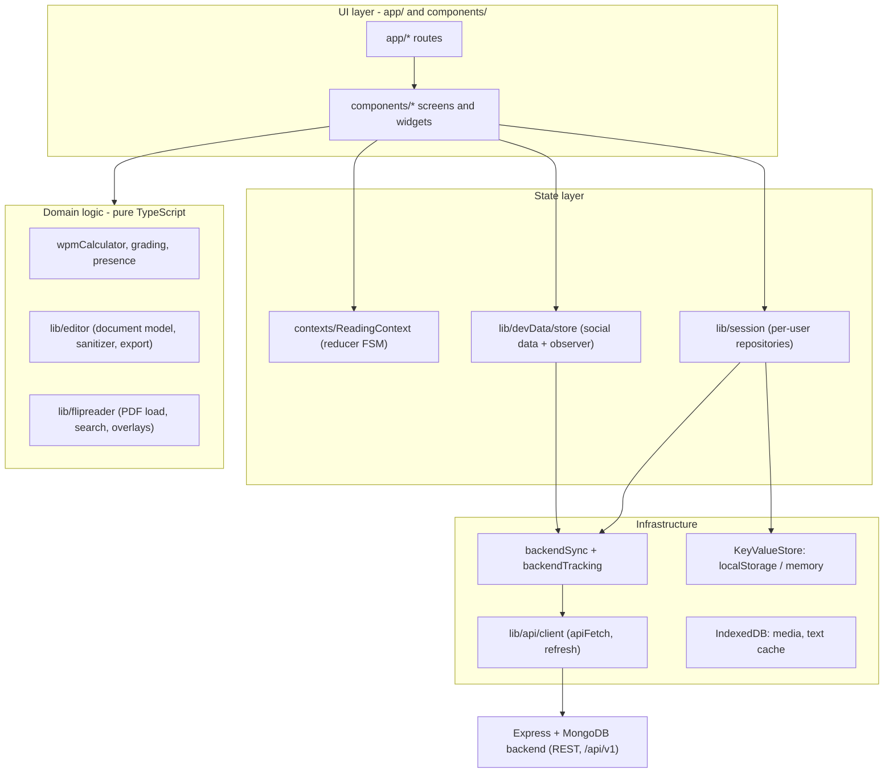

# Architecture overview

The whole Pacewise frontend on one page: what the layers are, which folder owns what, and where to read next. Every claim here points at real code in this repository (about 43,000 hand-written lines in roughly 320 files).

## 1. The product in one paragraph

Pacewise is a reading-practice platform. A person signs in, picks or uploads a story (text, PDF or images), reads it at a chosen speed (auto-scroll reader, free-scroll reading mode or a page-turning flip book), takes a quiz, and sees results, streaks, a calendar and time analytics. On top of that sit social features (like, dislike, comment, share, follow, playlists, notifications), a rich-text editor, a PDF flip-book editor with export, QR-shared public notes, and this documentation site with English and Hindi pages. The frontend is **Next.js 14 (App Router) + React 18 + TypeScript (strict)**, and it talks to a separate Express + MongoDB backend over REST.

## 2. The layers

| Layer | Folder | Rule it follows |
|---|---|---|
| Routes | `app/` | Thin: a page file picks a screen component and passes route params. No business logic. |
| Screens and widgets | `components/` | Grouped by feature (`Auth`, `Search`, `FlipReader`, `Editor`, `Notes` ...). Read state through hooks, never touch `localStorage` directly. |
| App-wide state | `contexts/`, `lib/devData/`, `lib/session/` | One owner per kind of state. React subscribes with `useReducer` or `useSyncExternalStore`. |
| Domain logic | `lib/editor/`, `lib/flipreader/`, `lib/*.ts` | Plain TypeScript, no React, unit-tested under `scripts/*.test.ts`. |
| Infrastructure | `lib/api/`, `lib/session/storage/` | The only code that knows about HTTP, tokens, `localStorage` and IndexedDB. |
| Docs site | `docs/`, `lib/docs/`, `components/Notes/` | Markdown bundled at build time into `lib/docs/*.generated.ts`. |

## 3. Five decisions that shape everything

1. **Local-first, server-mirrored.** Every action updates in-browser state first (instant UI), then a sync layer mirrors it to MongoDB. The app keeps working when the backend sleeps. Trade-off: two copies of data and last-write-wins conflicts.
2. **One owner per kind of state.** Reading flow lives in a reducer, social data in one store, per-user history in repositories. No component keeps a private copy of shared data.
3. **Per-user isolation by construction.** Storage keys are built only by `UserNamespace` (`srt:v2:u:<userId>:<feature>`), tokens are stored per user, and `SessionBoundary` remounts the tree when the user changes.
4. **Pure logic away from React.** Speed math, grading, presence, document model, search and QR encoding are classes or functions with no DOM, so they are testable with fake clocks and in-memory stores.
5. **Authentication only on the server.** The browser never checks a password. It keeps a short-lived access token and a rotating refresh token, and re-verifies the session with `GET /auth/me` on every load.

## 4. Pages in this folder

| # | Page | Read it when you need |
|---|---|---|
| 01 | [Folder and component map](01-folder-and-component-map.md) | "Which file does X?" for every folder and component |
| 02 | [Data flows](02-data-flows.md) | Step-by-step flows: sign-in, token refresh, reading session, like to notification, sync, new device, uploads, docs build |
| 03 | [Design patterns and trade-offs](03-design-patterns-and-trade-offs.md) | Every pattern used, where, why, and what it costs |
| 04 | [CS fundamentals by component](04-cs-fundamentals-by-component.md) | How CN, OS, DBMS and OOP show up in each component |
| 05 | [API design](05-api-design-rest-graphql-grpc.md) | The REST surface, error model, pagination, idempotency, and REST vs GraphQL vs gRPC |
| 06 | [Performance, testing and reliability](06-performance-testing-and-reliability.md) | Rendering performance, Web Vitals, tests, failure handling, security headers |
| 07 | [Scaling to 100M users](07-scaling-to-100m-users.md) | What changes at Reddit / Google scale for feeds, notifications, auth, sharing and SEO |
| 08 | [JD prep: Consumer Product Engineering](08-jd-consumer-product-engineering.md) | Each line of a big-tech job description mapped to proof in this project, with Easy / Medium / Hard questions |

Related pages elsewhere: [OOP architecture and sessions](../OOP_ARCHITECTURE.md), [Text editor](../TEXT_EDITOR.md), [Flip book engineering](../flip-book/README.md), [Deployment](../DEPLOYMENT.md), [World engineering references](../research/06-world-engineering-references.md).

## 5. How to explain this project in two minutes

- **Problem:** people want to read faster without losing comprehension, and want proof of progress.
- **Shape:** a Next.js client that is local-first, with a REST backend for identity, sync and analytics.
- **Hard parts you built:** a frame-accurate reading engine, per-user isolation on a shared browser, an offline-tolerant sync protocol (baseline diff + sequence cursor + idempotent events), a sanitising rich-text editor, and a virtualised PDF flip book with search and export.
- **What you would change at scale:** move notifications from polling to a push stream, move tokens to httpOnly cookies, replace last-write-wins with per-field merge, and move feed ranking to the server.
