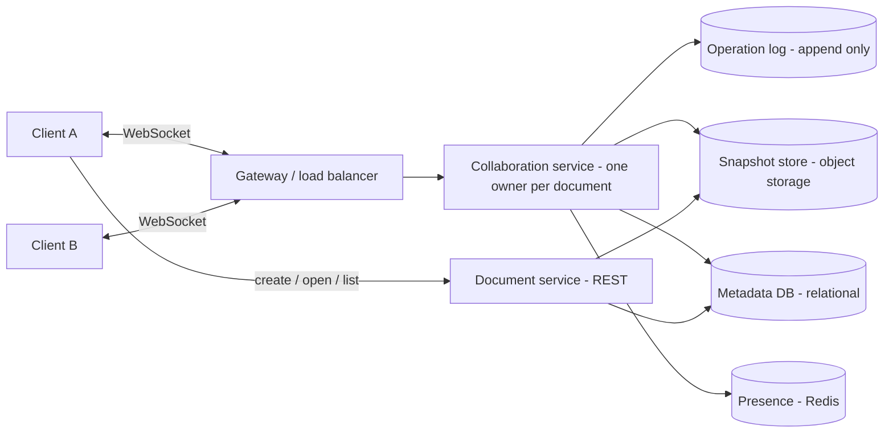

# 12 · System Design: Google Docs

**प्रश्न:** एक online collaborative document editor design करें (real-time co-editing, जैसे Google Docs)।
पूरा प्रश्न और walkthrough Educative पर: [System Design: Google Docs](https://www.educative.io/courses/grokking-the-system-design-interview/system-design-google-docs?aff=xjW0)

## Overview — प्रश्न के मुख्य बिंदु

- **Problem:** files को हाथ से आदान-प्रदान करने पर दो लोग local copies edit करते हैं, merging manual और error-prone होती है, और version conflicts तथा duplicated work होता है।
- **Google Docs जैसी service क्या देती है:** real-time collaboration (साथ में edit, review, comment), सामान्य browser से access, कहीं से भी काम, revert के साथ version history, और अक्सर मुफ़्त उपयोग।
- **दो architectures:** *client-server* (एक central service document state की मालिक होती है) या *peer-to-peer* (clients सीधे sync करते हैं)। Commercial products बेहतर control और consistency के लिए **client-server** चुनते हैं; हम भी यही चुनते हैं।
- **चार stages जिनमें problem हल की जाती है:**
  1. Requirements: functional requirements और infrastructure estimates।
  2. Design: components और वे आपस में कैसे interact करते हैं।
  3. Concurrency: एक साथ होने वाले edits से बने conflicts को हल करना।
  4. Evaluation: performance, consistency, availability, scalability।

नीचे **हमारा अपना solution** है, जो इन्हीं चार stages में हल किया गया है।

---

## Stage 1 — Requirements और estimates

**Functional (scope में)**

1. Browser में documents बनाना, खोलना, edit करना और delete करना।
2. कई लोग एक ही document को एक साथ edit करें और एक-दूसरे के बदलाव सेकंड के एक छोटे हिस्से में देखें।
3. देखना कि document में कौन है (cursors / presence)।
4. Version history: पुराने versions देखना और restore करना।

**पहले version के scope से बाहर:** comments, offline mode, fine-grained sharing UI (हम मानते हैं कि हर document पर एक सरल owner/editor/viewer role है)।

**Non-functional**

| लक्ष्य | Target |
| --- | --- |
| Latency | किसी दूसरे का edit लगभग 200 ms से कम में दिखे |
| Availability | उच्च: single-node failure के दौरान भी editing जारी रहे |
| Consistency | **Convergence:** सभी के पास अंत में एक जैसा text हो। *Read-your-writes:* आपका अपना edit तुरंत दिखे |
| Durability | Acknowledge किया गया edit कभी खोए नहीं |

**Estimates (assumptions, ज़ोर से बोलकर बताए गए)**

| मद | Assumption | नतीजा |
| --- | --- | --- |
| रोज़ के users | 10 million | |
| Peak factor | 5× | |
| एक doc पर concurrent editors | अधिकतम 100 (आम तौर पर 2–5) | |
| Edit rate | हर active editor पर लगभग 1 edit/second | peak पर 1 million active editors के साथ पूरे fleet में ≈ **1 million छोटे messages/second** |
| Document size | औसतन लगभग 100 KB, हर user के 10 docs | 10 M × 10 × 100 KB ≈ **10 TB** content |
| Bandwidth | एक edit message बहुत छोटा है (दसियों bytes से कुछ सौ तक) | content store से कहीं छोटा |

**निष्कर्ष:** कठिन हिस्सा storage नहीं है, बल्कि **बहुत सारे छोटे, ordered, low-latency messages** और हर document के edits को एक ही जगह रखना है।

---

## Stage 2 — Design



**Components और उनकी भूमिकाएँ**

| Component | भूमिका |
| --- | --- |
| Document service (REST) | Documents बनाना, list करना, खोलना, delete करना; permissions; latest snapshot और उसके बाद के operations लौटाना |
| Gateway | WebSockets को terminate करना, authenticate करना, **एक document के सभी connections को उसी collaboration server पर route करना** (`documentId` पर consistent hashing) |
| Collaboration service | Live document को memory में रखती है, आने वाले operations को order करती है, conflicting operations को transform करती है, और उन्हें broadcast करती है |
| Operation log | हर operation का append-only record (snapshots के बीच source of truth) |
| Snapshot store | Object storage में समय-समय पर पूरी copies (जैसे हर N operations या मिनट पर) |
| Metadata DB | Titles, owners, roles, timestamps — integrity और queries के लिए relational |
| Presence | Cursors और "यहाँ कौन है"; अल्पकालिक, इसलिए in-memory store ठीक है |

**WebSocket क्यों:** persistent, दो-तरफ़ा, low latency। Polling बहुत धीमा है; Server-Sent Events सिर्फ़ एक-तरफ़ा हैं।

**हर document का एक owner क्यों:** ordering ही पूरी समस्या है। अगर किसी document के सभी edits एक ही server से गुज़रें, तो वह server उन्हें एक single order दे सकता है। कई documents कई servers में बँटे होते हैं।

**API sketch**

```ts title="design/api.ts (sketch)" principle="Documents के लिए छोटी REST surface; सारी live editing एक WebSocket पर होती है"
// REST
POST   /api/documents            // { title } -> { documentId }
GET    /api/documents/:id        // -> { snapshot, baseVersion, opsSince }
DELETE /api/documents/:id

// WebSocket messages, per document
type ClientMsg =
  | { type: "op"; baseVersion: number; ops: Operation[] }   // my edit, based on version N
  | { type: "cursor"; position: number };
type ServerMsg =
  | { type: "ack"; version: number }                         // your op was applied at version V
  | { type: "op"; version: number; ops: Operation[]; author: string }
  | { type: "presence"; users: PresenceEntry[] };
```

**एक edit का flow:** client उसे तुरंत local रूप से apply करता है (ताकि typing instant लगे) → जिस version पर वह आधारित था उसके साथ `op` भेजता है → collaboration server उसे किसी भी नए operations के विरुद्ध transform करता है → log में append करता है → भेजने वाले को acknowledge करता है → बाकियों को broadcast करता है।

---

## Stage 3 — Concurrency (समस्या का मूल)

दो लोग एक ही क्षण में type करते हैं, दोनों एक ही version पर आधारित हैं। Text को **converge** होना चाहिए और हर व्यक्ति का **intent** बना रहना चाहिए।

| Approach | विचार | Trade-off |
| --- | --- | --- |
| Last write wins | नया save पुराने को बदल देता है | सरल, पर किसी का काम खो जाता है। स्वीकार्य नहीं |
| Locking | एक समय में सिर्फ़ एक editor | सुरक्षित, पर real-time collaboration खत्म हो जाता है |
| **Operational Transformation (OT)** | एक central server हर आने वाले operation को उन operations के विरुद्ध transform करता है जो उसने miss किए | Intent सुरक्षित रहता है; central server के साथ फिट बैठता है; transformation rules जटिल हैं |
| **CRDT** | हर character की एक unique, ordered id होती है ताकि edits commute करें | किसी central ordering की ज़रूरत नहीं, offline/P2P के लिए बढ़िया; हर character पर ज़्यादा metadata |

**हमारा चुनाव:** हर document के लिए central server के साथ OT, क्योंकि हम पहले ही client-server चुन चुके हैं और हमें कम metadata overhead चाहिए। अगर offline editing की ज़रूरत बनती है तो CRDTs upgrade का रास्ता हैं।

**हल किया गया उदाहरण।** Document: `Hello World`। A position 5 पर ` beautiful` insert करता है। B, उसी समय (A का edit देखने से पहले), position 5 पर ` amazing` insert करता है।

```ts title="design/transform.ts (sketch)" principle="Operational Transformation — किसी concurrent insert को पहले वाले insert के आगे खिसकाना"
type Insert = { pos: number; text: string; author: string };

// Rewrite `b` so it can be applied AFTER `a` has already been applied.
function transform(b: Insert, a: Insert): Insert {
  const bAfterA = b.pos > a.pos || (b.pos === a.pos && b.author > a.author); // tie-break by author id
  return bAfterA ? { ...b, pos: b.pos + a.text.length } : b;
}
```

Server को A पहले मिलता है, इसलिए A बिना बदलाव के apply होता है; B को A के विरुद्ध transform किया जाता है और वह उसके बाद आता है। सभी के पास अंत में एक जैसा text होता है। बराबर positions पर tie-break नतीजे को **deterministic** बनाता है, और यही convergence की गारंटी देता है।

**Version history:** snapshots और operation log मिलकर हमें कोई भी पुराना version दोबारा बनाने देते हैं (सबसे नज़दीकी पुराना snapshot load करें और operations replay करें)। पुराने operations को compact करके नए snapshots में बदला जा सकता है।

---

## Stage 4 — Evaluation

| Quality | Design इसे कैसे देता है | कमज़ोर बिंदु और mitigation |
| --- | --- | --- |
| Latency | पहले local apply, और ऐसे server तक एक hop जो document को पहले से memory में रखता है | दूर के users: कई regions में collaboration servers रखें और document के home पर route करें |
| Consistency | हर document का एक ordering point; OT convergence देता है; ack read-your-writes देता है | 100 editors वाला hot document अपने अकेले server को saturate कर सकता है: operations को batch करें, concurrent editors की सीमा रखें, broadcasts को compress करें |
| Availability | Stateless gateway; collaboration state को log + snapshot से दोबारा बनाया जा सकता है | अगर owner server मर जाए, तो दूसरा snapshot load करके log replay करता है (कुछ सेकंड); clients दोबारा connect होकर un-acked operations फिर भेजते हैं |
| Durability | Operations को acknowledge करने से **पहले** log में लिखा जाता है; log replicated है | Ack latency थोड़ी ज़्यादा; group commit का उपयोग करें |
| Scalability | Documents स्वतंत्र हैं: `documentId` से shard करें | Servers जोड़ने पर documents का rebalancing: consistent hashing सिर्फ़ थोड़ा हिस्सा हिलाता है |
| Security | Connect के समय और हर operation पर per-document role check | Access revoke करना: server उस user का socket बंद कर देता है |

**Interview में बताने योग्य failure cases:** edit के बीच client का offline होना (operations को local रूप से queue करें, reconnect पर rebase करें), duplicate delivery (operations में client id + sequence number होता है, server दोहराव को ignore करता है), broadcast के बाद पर ack से पहले server crash (client दोबारा भेजता है; duplicate rule इसे संभाल लेता है)।

**Pacewise से संबंध:** हमारा मौजूदा editor single-writer और local है (देखें *Research › Docs writing tool — strategy and challenges*)। यह page real-time co-editing का रास्ता है: WebSocket collaboration service, operation log और snapshots को इसी क्रम में जोड़ें।

## Self-check प्रश्न

1. एक document के सभी connections को उसी server पर route क्यों करें?
2. OT ऐसा क्या करता है जो last-write-wins नहीं करता?
3. Server के confirm करने से पहले हम edit को local रूप से apply क्यों करते हैं?
4. किसी document का version 120 कैसे दोबारा बनाएँगे?
5. अगर offline editing की ज़रूरत बन जाए तो क्या बदलेगा?
