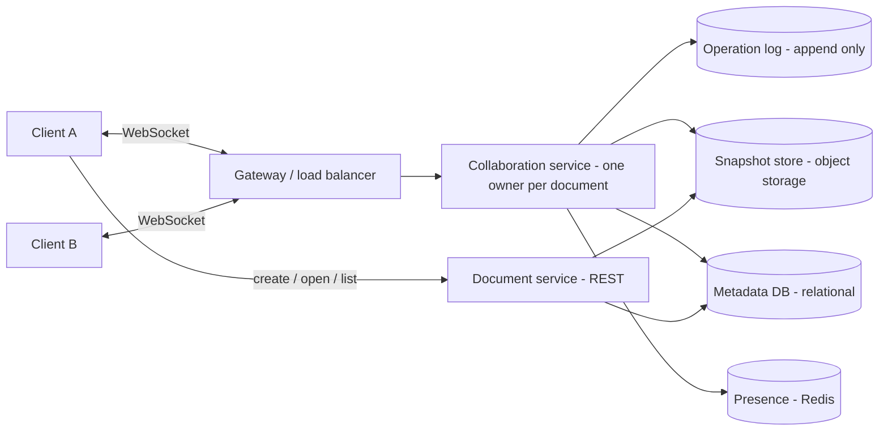

# 12 · System Design: Google Docs

**The question:** design an online collaborative document editor (real-time co-editing, like Google Docs).
Full question and walkthrough on Educative: [System Design: Google Docs](https://www.educative.io/courses/grokking-the-system-design-interview/system-design-google-docs?aff=xjW0)

## Overview — key points of the question

- **Problem:** exchanging files by hand means two people edit local copies, merging is manual and error-prone, and version conflicts and duplicated work follow.
- **What a service like Google Docs gives:** real-time collaboration (edit, review, comment together), access from a plain browser, work from anywhere, version history with revert, and often free use.
- **Two architectures:** *client-server* (a central service owns document state) or *peer-to-peer* (clients sync directly). Commercial products choose **client-server** for finer control and consistency; so do we.
- **The four stages the problem is solved in:**
  1. Requirements: functional requirements and infrastructure estimates.
  2. Design: components and how they interact.
  3. Concurrency: resolving conflicts from simultaneous edits.
  4. Evaluation: performance, consistency, availability, scalability.

Below is **our own solution**, worked through those four stages.

---

## Stage 1 — Requirements and estimates

**Functional (in scope)**

1. Create, open, edit and delete documents in the browser.
2. Several people edit the same document at once and see each other's changes within a fraction of a second.
3. See who is in the document (cursors / presence).
4. Version history: see and restore earlier versions.

**Out of scope for the first version:** comments, offline mode, fine-grained sharing UI (we assume a simple owner/editor/viewer role per document).

**Non-functional**

| Goal | Target |
| --- | --- |
| Latency | A remote edit appears in under about 200 ms |
| Availability | High: editing continues during a single-node failure |
| Consistency | **Convergence:** everyone ends with the same text. *Read-your-writes:* your own edit shows at once |
| Durability | An acknowledged edit is never lost |

**Estimates (assumptions, stated out loud)**

| Item | Assumption | Result |
| --- | --- | --- |
| Daily users | 10 million | |
| Peak factor | 5× | |
| Concurrent editors on one doc | up to 100 (typically 2–5) | |
| Edit rate | about 1 edit/second per active editor | with 1 million active editors at peak ≈ **1 million small messages/second** across the fleet |
| Document size | about 100 KB average, 10 docs per user | 10 M × 10 × 100 KB ≈ **10 TB** of content |
| Bandwidth | an edit message is tiny (tens of bytes to a few hundred) | far smaller than the content store |

**Takeaway:** the hard part is not storage, it is **many small, ordered, low-latency messages** and keeping each document's edits in one place.

---

## Stage 2 — Design



**Components and roles**

| Component | Role |
| --- | --- |
| Document service (REST) | Create, list, open, delete documents; permissions; returns the latest snapshot plus the operations after it |
| Gateway | Terminates WebSockets, authenticates, **routes all connections of one document to the same collaboration server** (consistent hashing on `documentId`) |
| Collaboration service | Keeps the live document in memory, orders incoming operations, transforms conflicting ones, broadcasts them |
| Operation log | Append-only record of every operation (the source of truth between snapshots) |
| Snapshot store | Periodic full copies (e.g. every N operations or minutes) in object storage |
| Metadata DB | Titles, owners, roles, timestamps — relational, for integrity and queries |
| Presence | Cursors and "who is here"; short-lived, so an in-memory store is fine |

**Why WebSocket:** persistent, two-way, low latency. Polling is too slow; Server-Sent Events are one-way only.

**Why one owner per document:** ordering is the whole problem. If all edits for a document pass through one server, that server can give them a single order. Many documents are spread across many servers.

**API sketch**

```ts title="design/api.ts (sketch)" principle="Small REST surface for documents; all live editing goes over one WebSocket"
// REST
POST   /api/documents            // { title } -> { documentId }
GET    /api/documents/:id        // -> { snapshot, baseVersion, opsSince }
DELETE /api/documents/:id

// WebSocket messages, per document
type ClientMsg =
  | { type: "op"; baseVersion: number; ops: Operation[] }   // my edit, based on version N
  | { type: "cursor"; position: number };
type ServerMsg =
  | { type: "ack"; version: number }                         // your op was applied at version V
  | { type: "op"; version: number; ops: Operation[]; author: string }
  | { type: "presence"; users: PresenceEntry[] };
```

**Flow of one edit:** client applies it locally at once (so typing feels instant) → sends `op` with the version it was based on → the collaboration server transforms it against any newer operations → appends to the log → acknowledges the sender → broadcasts to the others.

---

## Stage 3 — Concurrency (the heart of the problem)

Two people type at the same moment, each based on the same version. The text must **converge** and keep each person's **intent**.

| Approach | Idea | Trade-off |
| --- | --- | --- |
| Last write wins | The newest save replaces the older | Simple, but loses someone's work. Not acceptable |
| Locking | Only one editor at a time | Safe, but kills real-time collaboration |
| **Operational Transformation (OT)** | A central server transforms each incoming operation against the ones it missed | Preserves intent; fits a central server; transformation rules are intricate |
| **CRDT** | Every character has a unique, ordered id so edits commute | No central ordering needed, great for offline/P2P; more metadata per character |

**Our choice:** OT with a central server per document, because we already chose client-server and need low metadata overhead. CRDTs are the upgrade path if offline editing becomes a requirement.

**Worked example.** Document: `Hello World`. A inserts ` beautiful` at position 5. B, at the same time, inserts ` amazing` at position 5 (before seeing A's edit).

```ts title="design/transform.ts (sketch)" principle="Operational Transformation — shift a concurrent insert past an earlier insert"
type Insert = { pos: number; text: string; author: string };

// Rewrite `b` so it can be applied AFTER `a` has already been applied.
function transform(b: Insert, a: Insert): Insert {
  const bAfterA = b.pos > a.pos || (b.pos === a.pos && b.author > a.author); // tie-break by author id
  return bAfterA ? { ...b, pos: b.pos + a.text.length } : b;
}
```

The server receives A first, so A applies unchanged; B is transformed against A and lands after it. Everyone ends with the same text. The tie-break on equal positions makes the result **deterministic**, which is what guarantees convergence.

**Version history:** snapshots plus the operation log let us rebuild any past version (load the nearest earlier snapshot and replay operations). Old operations can be compacted into new snapshots.

---

## Stage 4 — Evaluation

| Quality | How the design delivers it | Weak spot and mitigation |
| --- | --- | --- |
| Latency | Local apply first, one hop to a server that already holds the document in memory | Far-away users: place collaboration servers in several regions and route to the document's home |
| Consistency | One ordering point per document; OT gives convergence; ack gives read-your-writes | A hot document with 100 editors can saturate its single server: batch operations, cap concurrent editors, compress broadcasts |
| Availability | Stateless gateway; collaboration state is rebuildable from log + snapshot | If the owner server dies, another loads the snapshot and replays the log (a few seconds); clients reconnect and resend un-acked operations |
| Durability | Operations are written to the log **before** being acknowledged; log is replicated | Slightly higher ack latency; use group commit |
| Scalability | Documents are independent: shard by `documentId` | Rebalancing documents when servers are added: consistent hashing moves only a small share |
| Security | Per-document role check at connect time and per operation | Revoke access: the server closes that user's socket |

**Failure cases to mention in an interview:** client offline mid-edit (queue operations locally, rebase on reconnect), duplicate delivery (operations carry client id + sequence number, server ignores repeats), server crash after broadcast but before ack (client resends; duplicate rule handles it).

**How it connects to Pacewise:** our current editor is single-writer and local (see *Research › Docs writing tool — strategy and challenges*). This page is the path to real-time co-editing: add the WebSocket collaboration service, the operation log, and snapshots, in that order.

## Self-check questions

1. Why route every connection of one document to the same server?
2. What does OT do that last-write-wins does not?
3. Why do we apply an edit locally before the server confirms it?
4. How do you rebuild version 120 of a document?
5. What changes if offline editing becomes a requirement?
